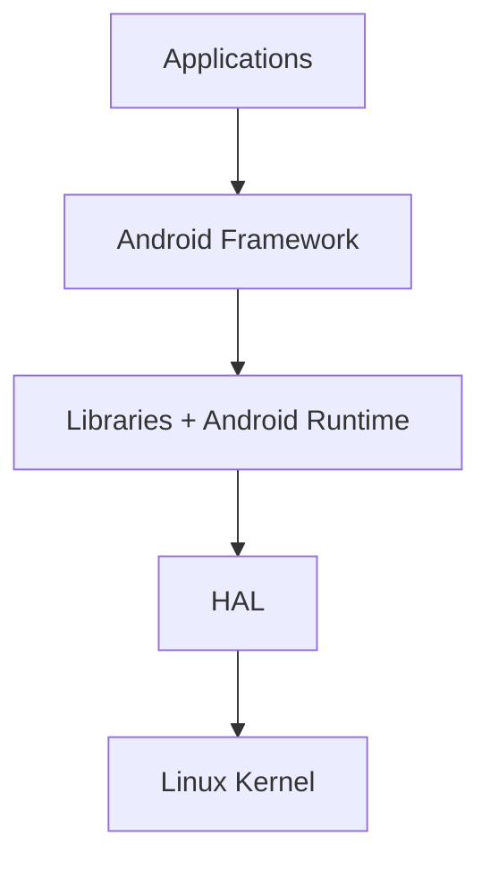

## Mở đầu

Sao khi đã lăn lộn với các kiến thức pentest webapp trong một thời gian rồi thì nay vừa đúng lúc có task mới thì mình học và tìm hiểu thêm 1 mảng mobile pentest nữa và sẽ note lại các điểm trong quá trình học thêm mục này vừa để  ghi nhớ và note lại. Bài đầu này dựa trên phần *Android Basics* trong khóa Android Application Security của Mobile Hacking Lab.

Mục tiêu đầu tiên là hiểu Android được tổ chức ra sao và một ứng dụng gồm những gì.

---

## 1. Kiến trúc Android

Android chia thành nhiều tầng xếp chồng lên nhau, từ trên xuống:

Mỗi tầng làm một việc riêng, và tầng nào cũng từng có lỗ hổng:

| Tầng | Làm gì | Ghi chú |
| --- | --- | --- |
| **Linux Kernel** | Quản lý bộ nhớ, tiến trình, network stack, driver | Có lỗi kernel, nhưng SELinux giúp giảm thiệt hại |
| **HAL** | Lớp giao tiếp giữa phần cứng và Android | Từng có lỗi, ví dụ ở audio DSP của MediaTek |
| **Libraries** | Thư viện C/C++ như SQLite, OpenSSL, WebKit | Lỗi ở đây ảnh hưởng mọi app dùng nó |
| **Android Runtime** | Chạy code của app | Dalvik VM trước đây, giờ là ART |
| **Framework** | API cấp cao cho dev: activity, service, UI... | Là thứ app gọi tới hằng ngày |
| **Applications** | App viết bằng Java hoặc Kotlin | Phần mình sẽ test nhiều nhất |

Về runtime, ART dùng biên dịch AOT (ahead-of-time), tức là biên dịch trước khi chạy, nên app nhanh hơn và tốn ít bộ nhớ hơn.

---

## 2. Android bảo vệ người dùng thế nào

Theo những gì mình đọc và hiểu được thì bảo mật Android được chia làm 4 nhóm:

**System security**
- Mã hóa thiết bị: file-based từ Android 7, full-disk từ Android 5.
- TEE (Trusted Execution Environment): nơi lưu thứ nhạy cảm như khóa mã hóa, sinh trắc học.
- Verified Boot: đảm bảo code chạy lúc khởi động đều đến từ nguồn tin cậy.

**Network security**
- TLS mặc định và DNS over TLS từ Android 9.
- Mỗi app có thể có network security config riêng.
- Hỗ trợ certificate pinning.

**Software isolation**
- SELinux áp dụng mandatory access control, nhốt mỗi app trong sandbox riêng.
- Quyền của app được khai báo trong manifest.

**Anti-exploitation**
- ASLR (từ Android 4.1), KASLR cho kernel (từ Android 8).
- DEP (Data Execution Prevention).
- Seccomp filter để giới hạn syscall.

> Với pentest app, hai thứ mình sẽ đụng nhiều nhất là certificate pinning (khi bắt traffic) và sandbox (khi tìm dữ liệu lưu trên máy).

---

## 3. Một ứng dụng Android gồm những gì

### API

App gọi vào hệ thống qua hai đường: Java API thông qua SDK, hoặc C/C++ thông qua NDK.

### Sandbox

Mỗi app chạy trong một "căn phòng" riêng:

- Có VM riêng.
- Có user và thư mục dữ liệu riêng, ví dụ `/data/data/com.mobilehackinglab.app`.
- Hai app có thể chia sẻ sandbox nếu dùng `sharedUserId`.

### Đóng gói

App được phát hành ở hai dạng:

- **APK** (Android Package Kit).
- **AAB** (Android App Bundle).

Một file APK chứa code, resource và file manifest.

### Manifest

`AndroidManifest.xml` là file mình sẽ mở đầu tiên với bất kỳ app nào. Nó khai báo:

- Các component của app.
- Các permission.
- Các flag cấu hình.

### Bốn loại component

| Component | Dùng để |
| --- | --- |
| **Activity** | Một màn hình giao diện |
| **Service** | Chạy tác vụ ở nền |
| **Broadcast Receiver** | Nhận sự kiện từ hệ thống hoặc app khác |
| **Content Provider** | Chia sẻ dữ liệu giữa các app |

### IPC

IPC (Inter-Process Communication) là cách các app, hay các sandbox, trao đổi dữ liệu với nhau. Android làm việc này qua **Binder framework** và **Intent**.

Đây chính là chỗ attack surface xuất hiện. Nếu một component được đánh dấu `android:exported="true"`, app khác (hoặc kẻ tấn công) có thể gọi tới nó. Các bài sau mình sẽ quay lại phần này nhiều.

---

## 4. Ký và phát hành app

**Ký app**
- Mọi app đều phải ký bằng chứng chỉ của nhà phát triển.
- Khi debug, app được ký bằng chứng chỉ tự tạo (self-signed).
- Lên Google Play thì cần khóa nhà phát triển hợp lệ.
- Có nhiều scheme ký, từ v1 đến v4.

**Phát hành app**
- Google Play Store.
- Store khác như Amazon Appstore.
- Hoặc không lên store, chỉ đưa link tải APK.

---

## Tóm lại

- Android gồm 6 tầng, từ Linux Kernel lên đến Applications.
- Bảo mật nằm ở nhiều lớp: mã hóa, verified boot, TLS, SELinux, ASLR...
- Mỗi app là một sandbox riêng, giao tiếp ra ngoài qua IPC.
- Một app có manifest và 4 loại component. Component `exported` chính là bề mặt tấn công.

---

## Nguồn

- Mobile Hacking Lab, *Android Application Security - Android Basics*.
- [OWASP MASTG](https://mas.owasp.org/MASTG/)
