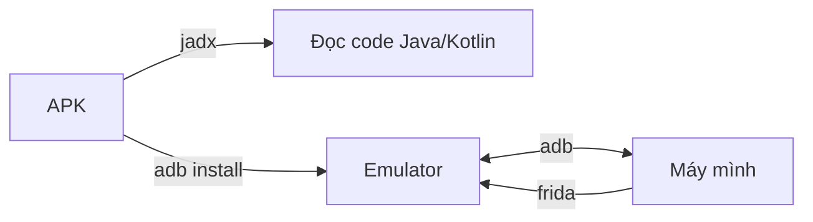
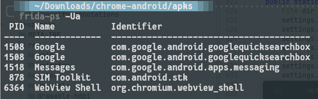
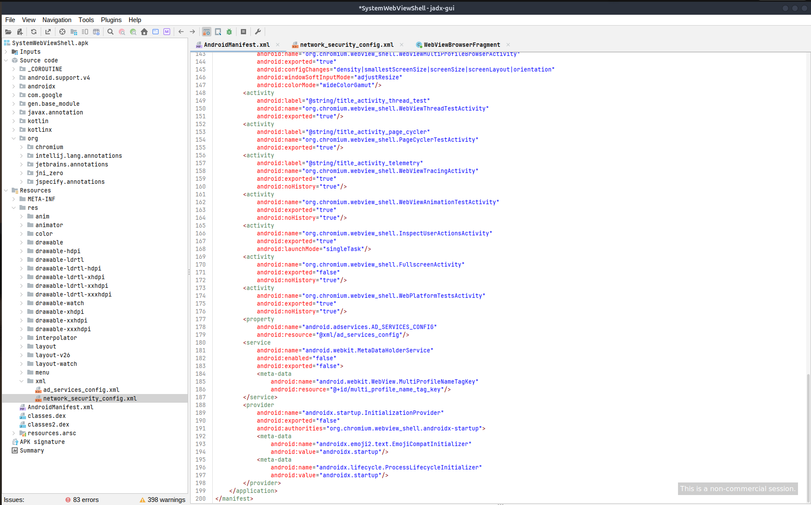

## Mở đầu

Ở phần trước thì đã đi qua kiến trúc và những thứ cơ bản của Android. Phần này là phần dựng lab. Cơ bản thì mình sẽ dùng 4 công cụ, đủ để bắt đầu test một app:

| Công cụ | Dùng để làm gì |
| --- | --- |
| **Android Studio** | Tạo máy ảo (emulator) để chạy app |
| **adb** | Điều khiển máy ảo từ terminal |
| **Frida** | Hook vào app lúc đang chạy |
| **JADX** | Đọc code của app (decompile) |

Chúng nối với nhau như sau:



Quy trình quen thuộc là đọc code bằng JADX để biết app làm gì, cài lên emulator bằng adb, rồi dùng Frida để can thiệp lúc app chạy.

Môi trường mình đang dùng: Ubuntu 24.04, Android Studio, máy ảo Android 13 (API 33), Frida 17.24.2, JADX 1.5.6.

---

## 1. Android Studio

Phần cài đặt các thứ rườm rà thì theo chatbot và guide từ trên internet dễ dàng để có thể tải và setup được phần này, cái quan trọng có lẽ là phiên bản emu mà ta sẽ sử dụng làm môi trường 

### Tạo máy ảo

Vào **Device Manager → Create Device**, rồi chọn:

1. Một thiết bị bất kỳ (ví dụ Pixel).
2. System image: **Android 13 (API 33)**, loại **Google APIs**, kiến trúc **x86_64**.
3. Đặt tên và tạo.

Điểm quan trọng nhất là chọn image **Google APIs**, đừng chọn **Google Play**. Image Google Play bị khóa, không root được. Image Google APIs cho phép chạy `adb root`, và Frida cần quyền này.

> Mình chọn API 33 vì còn khá mới nhưng ổn định với Frida. Nếu app cần chạy trên bản Android khác thì tạo thêm máy ảo khác.


## 2. adb

adb (Android Debug Bridge) là cầu nối giữa laptop và thiết bị (phần này sau này có cơ hội mình sẽ sắm thêm thiết bị real 1 ios và 1 android để làm cho nó thực tế ).

### Cài đặt

Cài đặt thì cx ko có gi quá rắc rối cả cơ bản thì adb đã nằm trong gói **platform-tools**. Android Studio đã tải sẵn khi cài SDK. Nếu chưa có thì cài riêng:


### Lên quyền root

Với image Google APIs:

```bash
adb root
adb shell id
```

Dòng `uid=0(root)` nghĩa là đã có root.

### Các lệnh mình dùng thường xuyên

```bash
adb install app.apk                    # cài app
adb install -r app.apk                 # cài đè
adb shell pm list packages | grep abc  # tìm package name
adb shell pm path com.example.app      # xem APK nằm ở đâu
adb pull <đường_dẫn> .                 # kéo file từ máy ảo về
adb push file /data/local/tmp/         # đẩy file lên máy ảo
adb shell                              # mở shell
adb logcat                             # xem log
```

---

## 3. Frida

Frida là công cụ **dynamic instrumentation**. Hiểu đơn giản: nó cho mình chèn JavaScript vào app đang chạy để xem hoặc đổi hành vi của hàm, mà không cần sửa APK.

Frida gồm hai phần cần cài:

- **Phía máy tính**: `frida` và `frida-tools`.
- **Phía thiết bị**: `frida-server`.

### Cài phía máy tính

```bash
pipx install frida-tools
frida --version
```

Mình dùng pipx để tránh làm hỏng Python hệ thống. Dùng `pip install frida-tools` trong virtualenv cũng được.

### Cài frida

Riêng món này thì sẽ cần chú ý hơn 1 chút ta cần cài frida lên hai phía đó là ở máy lap của mình và 1 frida-server vào trong thiết bị test, 2 phiên bản này cần giống nhau 

1. Xem phiên bản Frida trên máy: `frida --version` (của mình là `17.24.2`).

2. Vào trang Releases của Frida trên GitHub, tải file `frida-server-<phiên_bản>-android-x86_64.xz`. Phiên bản phải **trùng** với bản trên máy.
3. Giải nén, đẩy lên máy ảo và chạy:

```bash
unxz frida-server-*-android-x86_64.xz
adb root
adb push frida-server-* /data/local/tmp/frida-server
adb shell chmod +x /data/local/tmp/frida-server
adb shell "/data/local/tmp/frida-server &"
```

> Chọn đúng kiến trúc. Emulator x86_64 dùng `android-x86_64`. Thiết bị thật thường là `android-arm64`.

### Kiểm tra

Liệt kê tiến trình trên máy ảo:

```bash
frida-ps -U
```

Cờ `-U` nghĩa là kết nối qua USB/adb. Nếu ra danh sách tiến trình tức là Frida đã hoạt động.



---

## 4. JADX

JADX biến file APK (bytecode DEX) thành code Java đọc được. Đây là công cụ mình dùng để hiểu app làm gì trước khi động vào nó.

### Cài đặt

Cách nhanh nhất là tải bản release trên GitHub của JADX, giải nén, rồi thêm thư mục `bin` vào `PATH`. JADX cần Java.


JADX có hai dạng:

- `jadx-gui`: giao diện đồ họa, tiện để đọc code.
- `jadx`: dòng lệnh, tiện để xuất cả project ra thư mục rồi `grep`.

mình thì dùng gui thôi cho dễ tương tác và xem code khi cài thành công và mở 1 file apk thì kết quả sẽ tương tự như dưới ảnh 



> JADX không hoàn hảo. Có những hàm decompile ra thất bại hoặc khó hiểu.
{: .prompt-info }

---

## Tóm lại

- **Android Studio**: chỉ để tạo emulator. Nhớ chọn image Google APIs để root được.
- **adb**: cầu nối với máy ảo, dùng cho cài app, kéo file, mở shell.
- **Frida**: cần client trên máy và `frida-server` trên máy ảo, hai bên **phải cùng phiên bản**.
- **JADX**: đọc code app, bắt đầu từ `AndroidManifest.xml`.

Bài sau mình sẽ bắt traffic của app qua Burp Suite và xử lý chuyện certificate. Sau đó là dùng JADX và Frida để phân tích một app cụ thể.
