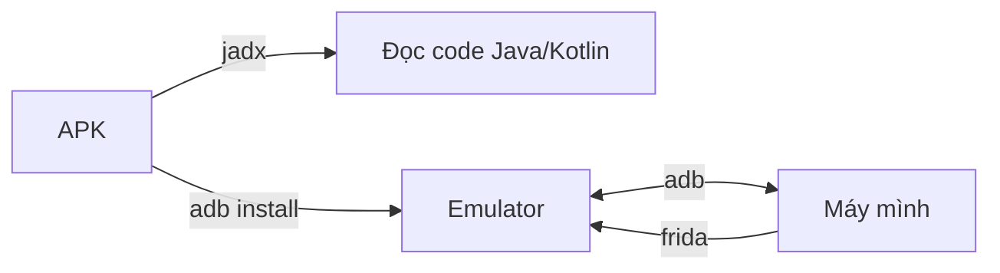

## Mở đầu

Bài trước mình đã đi qua kiến trúc và những thứ cơ bản của Android. Bài này là phần dựng lab. Mình chỉ dùng 4 công cụ, đủ để bắt đầu test một app:

| Công cụ | Dùng để làm gì |
| --- | --- |
| **Android Studio** | Tạo máy ảo (emulator) để chạy app |
| **adb** | Điều khiển máy ảo từ terminal |
| **Frida** | Hook vào app lúc đang chạy |
| **JADX** | Đọc code của app (decompile) |

Chúng nối với nhau như sau:



Quy trình quen thuộc là đọc code bằng JADX để biết app làm gì, cài lên emulator bằng adb, rồi dùng Frida để can thiệp lúc app chạy.

Môi trường mình đang dùng: Ubuntu 24.04, Android Studio, máy ảo Android 13 (API 33), Frida 17.24.2, JADX 1.5.6.

---

## 1. Android Studio

Mình không dùng Android Studio để viết app. Mình chỉ cần nó để tạo **emulator**.

### Cài đặt

Tải từ trang chính thức của Android Studio, giải nén rồi chạy `studio.sh`. Lần đầu mở, cứ để wizard tải SDK về.

### Tạo máy ảo

Vào **Device Manager → Create Device**, rồi chọn:

1. Một thiết bị bất kỳ (ví dụ Pixel).
2. System image: **Android 13 (API 33)**, loại **Google APIs**, kiến trúc **x86_64**.
3. Đặt tên và tạo.

Điểm quan trọng nhất là chọn image **Google APIs**, đừng chọn **Google Play**. Image Google Play bị khóa, không root được. Image Google APIs cho phép chạy `adb root`, và Frida cần quyền này.

> Mình chọn API 33 vì còn khá mới nhưng ổn định với Frida. Nếu app cần chạy trên bản Android khác thì tạo thêm máy ảo khác.
{: .prompt-tip }

### Chạy máy ảo

Có thể bấm nút play trong Device Manager, hoặc chạy từ terminal cho nhẹ (không cần mở Android Studio):

```bash
emulator -list-avds
emulator -avd <tên_avd>
```

---

## 2. adb

adb (Android Debug Bridge) là công cụ mình dùng nhiều nhất. Nó là cầu nối giữa máy tính và thiết bị.

### Cài đặt

adb nằm trong gói **platform-tools**. Android Studio đã tải sẵn khi cài SDK. Nếu chưa có thì cài riêng:

```bash
sudo apt install adb
```

Hoặc tải platform-tools từ Google, giải nén rồi thêm vào `PATH`. Kiểm tra:

```bash
adb version
```

### Kết nối

Bật emulator rồi chạy:

```bash
adb devices
```

Kết quả mong đợi:

```text
List of devices attached
emulator-5554	device
```

Nếu thấy `unauthorized` hoặc không thấy máy nào, thử `adb kill-server` rồi `adb start-server`.

### Lên quyền root

Với image Google APIs:

```bash
adb root
adb shell id
```

Dòng `uid=0(root)` nghĩa là đã có root.

### Các lệnh mình dùng thường xuyên

```bash
adb install app.apk                    # cài app
adb install -r app.apk                 # cài đè
adb shell pm list packages | grep abc  # tìm package name
adb shell pm path com.example.app      # xem APK nằm ở đâu
adb pull <đường_dẫn> .                 # kéo file từ máy ảo về
adb push file /data/local/tmp/         # đẩy file lên máy ảo
adb shell                              # mở shell
adb logcat                             # xem log
```

---

## 3. Frida

Frida là công cụ **dynamic instrumentation**. Hiểu đơn giản: nó cho mình chèn JavaScript vào app đang chạy để xem hoặc đổi hành vi của hàm, mà không cần sửa APK.

Frida gồm hai phần cần cài:

- **Phía máy tính**: `frida` và `frida-tools`.
- **Phía thiết bị**: `frida-server`.

### Cài phía máy tính

```bash
pipx install frida-tools
frida --version
```

Mình dùng pipx để tránh làm hỏng Python hệ thống. Dùng `pip install frida-tools` trong virtualenv cũng được.

### Cài frida-server lên máy ảo

1. Xem phiên bản Frida trên máy: `frida --version` (của mình là `17.24.2`).
2. Vào trang Releases của Frida trên GitHub, tải file `frida-server-<phiên_bản>-android-x86_64.xz`. Phiên bản phải **trùng** với bản trên máy.
3. Giải nén, đẩy lên máy ảo và chạy:

```bash
unxz frida-server-*-android-x86_64.xz
adb root
adb push frida-server-* /data/local/tmp/frida-server
adb shell chmod +x /data/local/tmp/frida-server
adb shell "/data/local/tmp/frida-server &"
```

> Chọn đúng kiến trúc. Emulator x86_64 dùng `android-x86_64`. Thiết bị thật thường là `android-arm64`.
{: .prompt-warning }

Chú ý `frida-server` sẽ mất khi máy ảo khởi động lại, mỗi lần bật máy ảo phải chạy lại lệnh cuối.

### Kiểm tra

Liệt kê tiến trình trên máy ảo:

```bash
frida-ps -U
```

Cờ `-U` nghĩa là kết nối qua USB/adb. Nếu ra danh sách tiến trình tức là Frida đã hoạt động.

Thử một đoạn hook nhỏ, in ra model của máy:

```javascript
// test.js
Java.perform(function () {
    var Build = Java.use("android.os.Build");
    console.log("model = " + Build.MODEL.value);
});
```

```bash
frida -U -n Messages -l test.js
```

Kết quả sẽ in `model = sdk_gphone64_x86_64`. Có dòng này là mình đã chạy được code trong một app thật.

### Lỗi hay gặp

| Lỗi | Nguyên nhân thường gặp |
| --- | --- |
| `unable to connect to remote frida-server` | `frida-server` chưa chạy, hoặc chưa `adb root` |
| `server and client version mismatch` | Hai phía khác phiên bản |
| `Permission denied` khi chạy server | Quên `chmod +x` |
| `process not found` | Tên tiến trình sai, xem lại bằng `frida-ps -U` |

---

## 4. JADX

JADX biến file APK (bytecode DEX) thành code Java đọc được. Đây là công cụ mình dùng để hiểu app làm gì trước khi động vào nó.

### Cài đặt

Cách nhanh nhất là tải bản release trên GitHub của JADX, giải nén, rồi thêm thư mục `bin` vào `PATH`. JADX cần Java. Kiểm tra:

```bash
java -version
jadx --version
```

JADX có hai dạng:

- `jadx-gui`: giao diện đồ họa, tiện để đọc code.
- `jadx`: dòng lệnh, tiện để xuất cả project ra thư mục rồi `grep`.

### Dùng GUI

```bash
jadx-gui app.apk
```

Một số thứ mình hay xem đầu tiên:

1. `Resources → AndroidManifest.xml`: xem component nào `exported`, app xin quyền gì.
2. `Source code`: tìm class `MainActivity` và các class có tên liên quan đến login, API, crypto.
3. `Ctrl + Shift + F`: tìm toàn bộ code, ví dụ tìm `http`, `password`, `key`, `token`.

### Dùng dòng lệnh

```bash
jadx -d app_out app.apk
grep -rn "api_key" app_out/sources/
```

Một vài cờ hữu ích:

| Cờ | Tác dụng |
| --- | --- |
| `-d <thư_mục>` | Thư mục xuất kết quả |
| `--deobf` | Đổi tên các class bị làm rối (obfuscate) sang tên dễ đọc hơn |
| `--show-bad-code` | Vẫn hiện những đoạn decompile lỗi, đỡ bị trống |
| `-j <số>` | Số luồng xử lý |

> JADX không hoàn hảo. Có những hàm decompile ra thất bại hoặc khó hiểu, khi đó cần kết hợp với `--show-bad-code` hoặc đọc smali.
{: .prompt-info }

---

## Kiểm tra toàn bộ lab

Sau khi cài xong, mình chạy qua danh sách này để chắc mọi thứ ổn:

```bash
adb devices            # thấy emulator-5554 device
adb shell id           # uid=0(root)
frida --version        # có phiên bản
frida-ps -U            # thấy danh sách tiến trình
jadx --version         # có phiên bản
```

Cả 5 lệnh đều ra kết quả đúng là lab đã sẵn sàng.

---

## Tóm lại

- **Android Studio**: chỉ để tạo emulator. Nhớ chọn image Google APIs để root được.
- **adb**: cầu nối với máy ảo, dùng cho cài app, kéo file, mở shell.
- **Frida**: cần client trên máy và `frida-server` trên máy ảo, hai bên **phải cùng phiên bản**.
- **JADX**: đọc code app, bắt đầu từ `AndroidManifest.xml`.

Bài sau mình sẽ bắt traffic của app qua Burp Suite và xử lý chuyện certificate. Sau đó là dùng JADX và Frida để phân tích một app cụ thể.
