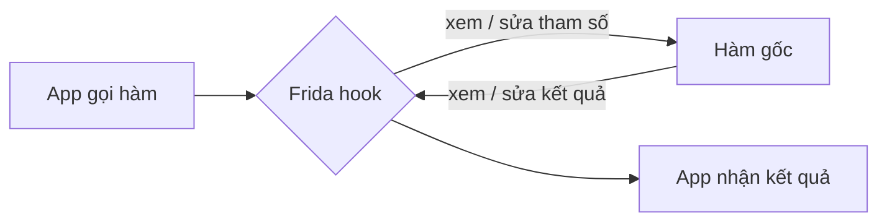
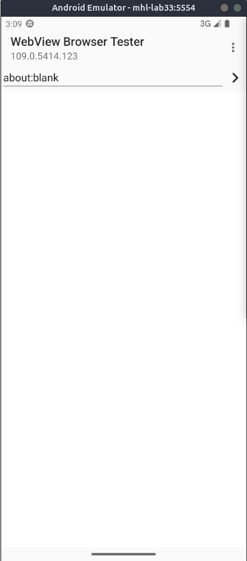
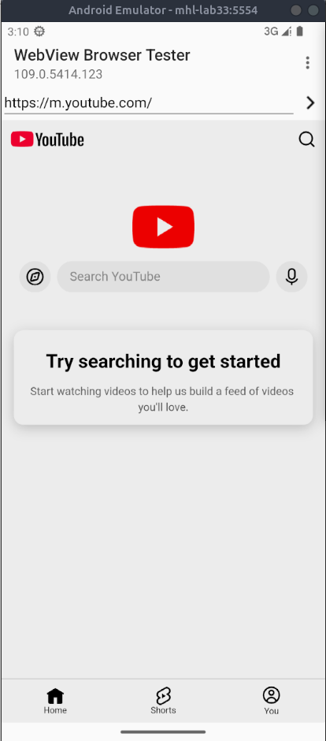
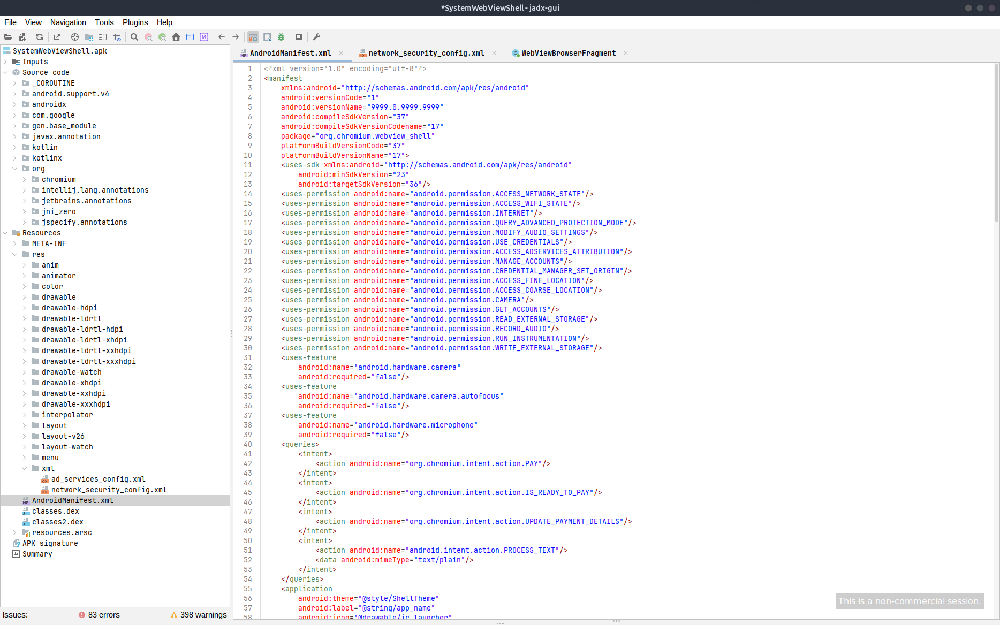
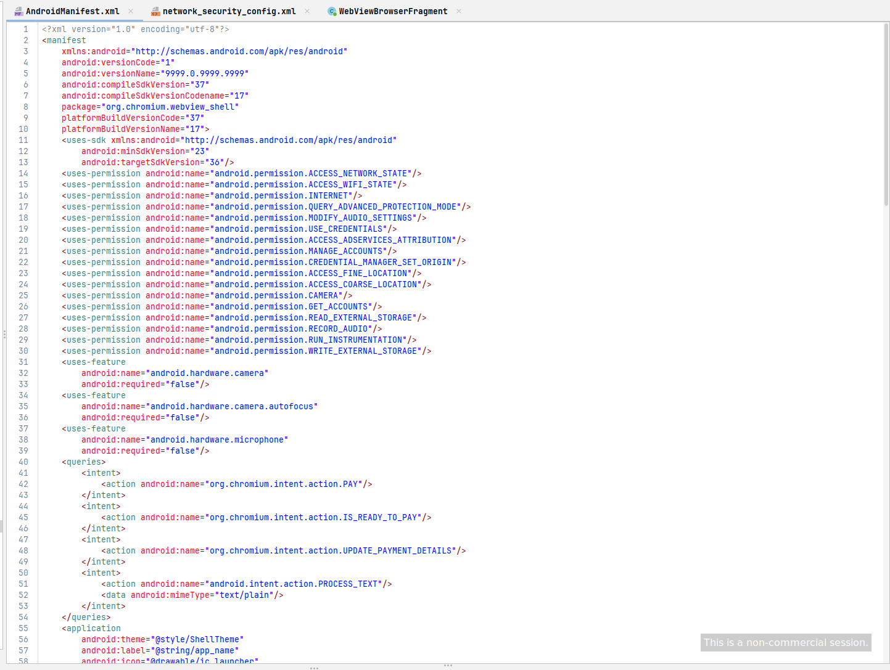
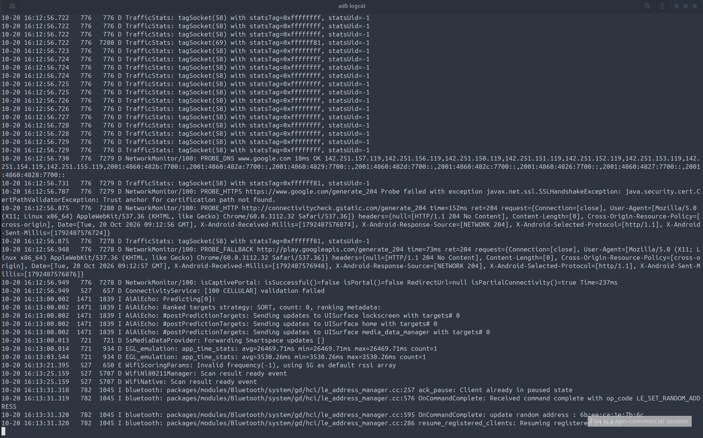
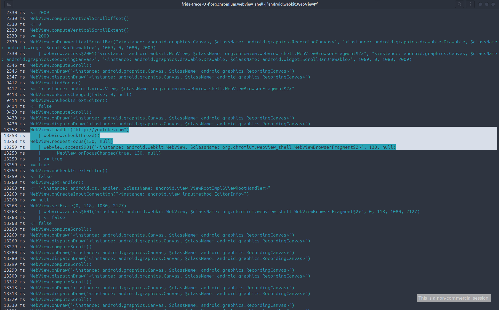
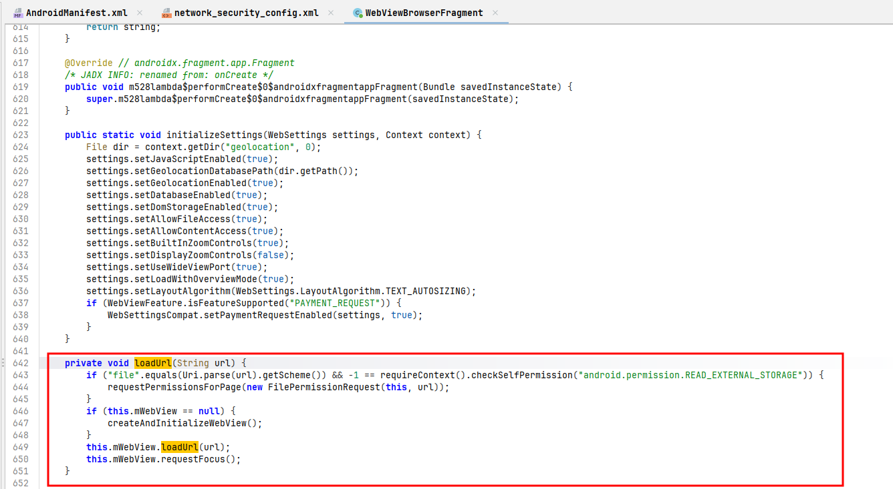

## Mở đầu

2 Bài trước thì cũng đi sơ qua những cái kiến thức và môi trường rồi thì bây giờ ta vọc vạch vào dùng frida để tập tành hook thử các hàm trong 1 lab nhỉ.
Mình sẽ dùng Frida để hook vào 1 ứng dụng lab mô phỏng có chức năng websearch cơ bản nhằm điều hướng chức năng tìm kiếm sẽ luôn trỏ về url mà ta chỉ định.

---

## 1. Hook là gì


Hook là chèn code của mình vào một hàm của app **lúc nó đang chạy**, để xem tham số, xem giá trị trả về, hoặc thay đổi chúng. Không cần sửa file APK, không cần ký lại.



---

## 2. Bước 1: Tìm mục tiêu cần hook

### Chạy thử app



oke bài app của lab này khá đơn giản rồi ta nhập các url mong muốn và app sẽ trả kết quả search trên internet thôi

Với mục tiêu đã đặt ra thì bài toán là cần tìm xem hàm nào đang xử lý chức năng này thì ta mới tìm cách can thiệp tiếp được. 

### Đọc code bằng JADX

Oke thì trước tiên đúng quy trình vẫn là ném file vào jadx để xem mặt mũi nó ra sao nhỉ 

> hmm real fact là mình cũng ko thích đọc code mobile lắm cho dù đã từng làm 1 project nhx cũng đã là từ rất lâu rồi 


nhìn vào file manifest thì cũng thấy được các thông tin và các component của app rồi nhưng mà để đạt được mục tiêu tìm hàm hook thì ở điểm này ta chắc phải chuyển sang cách khác khả thi hơn 

### Phân tích qua log abd và frida

Tiếp đến nếu ko thể mò mập trong đống code thì ta hướng đấn việc đọc log thôi
> như mentor mình đã dặn là log sẽ luôn cho ta biết được mọi thứ đang diễn ra như nào 

thử trước với logcat của adb 

không ngoài dự đoán thì log từ adb khá nhiễu và ko thu được manh mối gì nhiều lắm 

Tiếp đến thì minh trace thẳng theo thời gian để quan sát được các hàm được gọi đến 
Vì hầu hết app, dù tên hàm riêng là gì, đều phải đi qua các lớp có sẵn của Android hoặc thư viện phổ biến.
```bash
frida-trace -U -f org.chromium.webview_shell -j 'android.webkit.WebView!*'
```

ngon rồi bắt được luôn class và func chứa nơi xử lý chức năng này, ta search ngay trong jadx


oke tiếp đến thì viết script hook test điều hướng 


### Bản hoàn chỉnh: thay đổi hành vi

```javascript
// TODO: script cuối cùng
```

TODO: Giải thích những dòng quan trọng. Nếu hàm có overload thì ghi chú cách xử lý bằng `.overload(...)`.

> TODO (tùy chọn): ghi chú những chỗ bạn bị vấp, ví dụ sai tên class, hàm bị overload, app crash khi hook.
{: .prompt-tip }

---

## 4. Bước 3: Chạy script

Chạy `frida-server` trên máy ảo (nếu chưa chạy), rồi:

```bash
# Gắn vào app đang chạy
frida -U -n "TODO: tên tiến trình" -l hook.js

# Hoặc khởi chạy app cùng với script
frida -U -f TODO.package.name -l hook.js
```

TODO: Nên dùng cách nào cho case này và vì sao (`-n` gắn vào app đang chạy, `-f` spawn từ đầu, cần khi kiểm tra chạy ngay lúc khởi động).

---

## 5. Kết quả

TODO: Trước và sau khi hook, app khác nhau thế nào. Ảnh chụp hoặc output so sánh.

| | Trước khi hook | Sau khi hook |
| --- | --- | --- |
| Hành vi | TODO | TODO |
| Kết quả | TODO | TODO |


---

## 6. Vì sao hook được, và dev nên vá thế nào

<!-- Phần này làm bài có giá trị hơn một bài "làm theo là ra". 2-4 gạch đầu dòng là đủ. -->

- **Nguyên nhân:** TODO, ví dụ: kiểm tra chỉ nằm ở phía client nên người dùng kiểm soát được.
- **Mức độ ảnh hưởng:** TODO
- **Cách khắc phục:** TODO, ví dụ: chuyển kiểm tra xuống server, thêm kiểm tra toàn vẹn, obfuscation (chỉ làm khó chứ không ngăn được).

---

## Tóm lại

<!-- 3-4 gạch đầu dòng. Nhắc lại luồng làm. -->

1. Chạy thử app và đọc code bằng JADX để tìm hàm cần hook.
2. Viết script Frida, bắt đầu bằng bản chỉ in log.
3. Sau khi hiểu hàm nhận và trả gì thì mới sửa.
4. TODO: bài học riêng của case này.

Bài sau: TODO (ví dụ: bắt traffic qua Burp và xử lý SSL pinning).

---

## Tham khảo

- [Frida Documentation](https://frida.re/docs/home/)
- [OWASP MASTG](https://mas.owasp.org/MASTG/)
- TODO: nguồn lab / app
