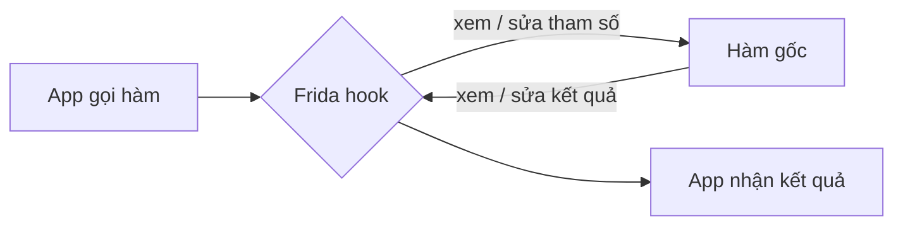
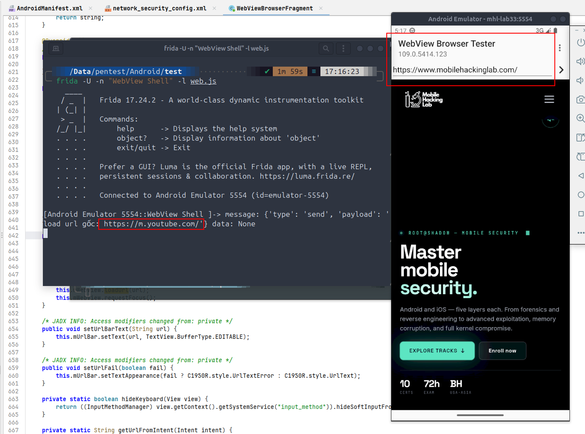

## Mở đầu

2 Bài trước thì cũng đi sơ qua những cái kiến thức và môi trường rồi thì bây giờ ta vọc vạch vào dùng frida để tập tành hook thử các hàm trong 1 lab nhỉ.
Mình sẽ dùng Frida để hook vào 1 ứng dụng lab mô phỏng có chức năng websearch cơ bản nhằm điều hướng chức năng tìm kiếm sẽ luôn trỏ về url mà ta chỉ định.

---

## 1. Hook là gì


Hook là chèn code của mình vào một hàm của app **lúc nó đang chạy**, để xem tham số, xem giá trị trả về, hoặc thay đổi chúng. Không cần sửa file APK, không cần ký lại.



---

## 2. Bước 1: Tìm mục tiêu cần hook

### Chạy thử app


oke bài app của lab này khá đơn giản rồi ta nhập các url mong muốn và app sẽ trả kết quả search trên internet thôi

Với mục tiêu đã đặt ra thì bài toán là cần tìm xem hàm nào đang xử lý chức năng này thì ta mới tìm cách can thiệp tiếp được. 

### Đọc code bằng JADX

Oke thì trước tiên đúng quy trình vẫn là ném file vào jadx để xem mặt mũi nó ra sao nhỉ 


> hmm real fact là mình cũng ko thích đọc code mobile lắm cho dù đã từng làm 1 project nhx cũng đã là từ rất lâu rồi 


nhìn vào file manifest thì cũng thấy được các thông tin và các component của app rồi nhưng mà để đạt được mục tiêu tìm hàm hook thì ở điểm này ta chắc phải chuyển sang cách khác khả thi hơn 

### Phân tích qua log abd và frida

Tiếp đến nếu ko thể mò mập trong đống code thì ta hướng đấn việc đọc log thôi
> như mentor mình đã dặn là log sẽ luôn cho ta biết được mọi thứ đang diễn ra như nào 

thử trước với logcat của adb 


không ngoài dự đoán thì log từ adb khá nhiễu và ko thu được manh mối gì nhiều lắm 

Tiếp đến thì minh trace thẳng theo thời gian để quan sát được các hàm được gọi đến 
Vì hầu hết app, dù tên hàm riêng là gì, đều phải đi qua các lớp có sẵn của Android hoặc thư viện phổ biến.

```bash
frida-trace -U -f org.chromium.webview_shell -j 'android.webkit.WebView!*'
```


ngon rồi bắt được luôn class và func chứa nơi xử lý chức năng này, ta search ngay trong jadx


## 3. Bước 2: viết và chạy script
oke tiếp đến thì viết script hook test điều hướng 

```javascript
Java.perform(function () {
  var F = Java.use("org.chromium.webview_shell.WebViewBrowserFragment");

  F["loadUrl"].implementation = function (url) {
    send("load url gốc: " + url);
    this["loadUrl"]("https://mobilehackinglab.com");
  };
});
```
viết theo đúng guide hướng dẫn từ frida 

### Giải thích từng dòng của script

Script chỉ có 3 ý chính: **vào đúng ngữ cảnh Java → tìm class → thay ruột hàm**. Đi từng phần nhé:

**1. `Java.perform(function () { ... });`**

App Android chạy code Java trên một máy ảo (ART). Frida muốn đụng vào code Java thì phải "đứng" đúng trong máy ảo đó, và `Java.perform` làm việc này. Mọi đoạn code thao tác với class/hàm Java đều phải nằm trong cái khung này, cứ coi nó là phần mở đầu bắt buộc.

**2. `var F = Java.use("org.chromium.webview_shell.WebViewBrowserFragment");`**

`Java.use("tên.class.đầy.đủ")` giúp ta lấy được class đó để thao tác. Tên class này chính là cái bắt được ở bước `frida-trace` và đối chiếu lại trong JADX (package + tên class). Sau dòng này, biến `F` đại diện cho class, ta có thể truy cập các hàm của nó qua `F["tên_hàm"]`.

**3. `F["loadUrl"].implementation = function (url) { ... };`**

Đây là dòng quan trọng nhất. Gán `.implementation` nghĩa là: *"từ giờ mỗi khi app gọi `loadUrl`, đừng chạy hàm gốc nữa mà chạy hàm của tôi"*.

- `function (url)` phải có **đúng số tham số** như hàm gốc. Ở đây `loadUrl` nhận 1 tham số là URL nên ta đặt tên nó là `url`. Giá trị mà app định load sẽ được truyền vào biến này, nên ta đọc và sửa được nó.
- Nếu hàm gốc bị **overload** (cùng tên nhưng khác kiểu tham số) thì Frida sẽ báo lỗi và yêu cầu chỉ rõ bản nào, khi đó dùng `F["loadUrl"].overload("java.lang.String").implementation = ...`.

**4. `send("load url gốc: " + url);`**

`send()` gửi một dòng log về máy tính của mình. Dòng này để quan sát: biết được app **định** load URL nào trước khi bị mình đổi. Đây là phần "xem tham số" trong sơ đồ ở mục 1.

**5. `this["loadUrl"]("https://mobilehackinglab.com");`**

Trong `implementation`, `this` là đối tượng đang gọi hàm. Dòng này gọi lại **hàm `loadUrl` gốc** nhưng truyền vào URL do mình chọn thay vì `url` mà app đưa. Đây là phần "sửa tham số", và cũng là lý do mọi thứ nhập vào đều bị điều hướng về cùng một trang.

khi t hook và quan sát sẽ thấy mọi url nhập vào ô tìm kiếm sẽ luôn được điều hướng về url ta đã chỉ định 



---

## Tham khảo

- [Frida Documentation](https://frida.re/docs/home/)
- [OWASP MASTG](https://mas.owasp.org/MASTG/)
- TODO: nguồn lab / app
