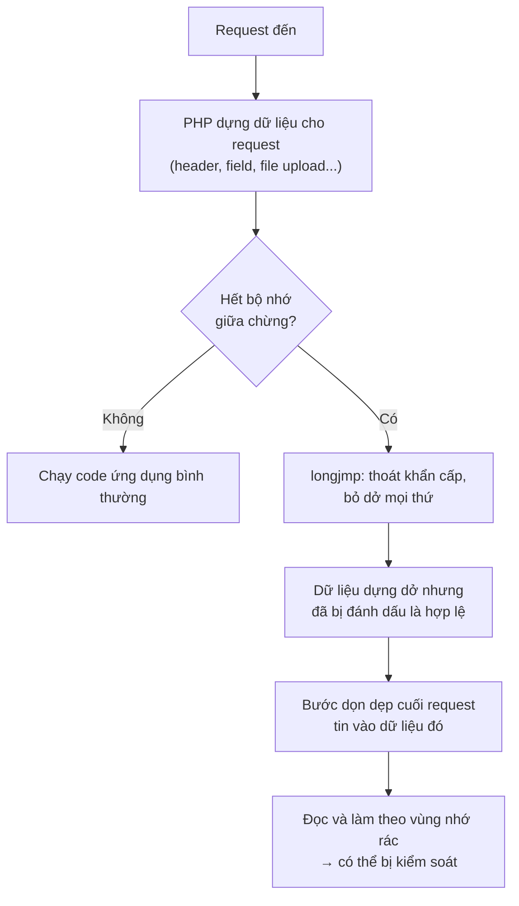
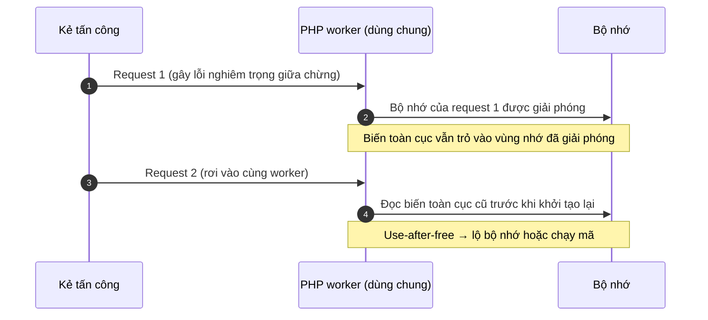

## Mở đầu

Mấy ngày nay nếu khá xôn sao cái tên **PHP2Shell**. Một số cơ quan chính phủ ở châu Âu tạm tắt website để vá, Cloudflare phải bật rule chặn khẩn cấp, còn cơ quan an ninh mạng Anh khuyên hệ thống nào chưa vá được thì nên ngắt khỏi internet.

Lý do đơn giản: đây là **hai lỗ hổng nằm ngay trong lõi PHP**, không phải trong một plugin hay một framework nào. Kẻ tấn công không cần tài khoản, chỉ cần gửi một HTTP request là có thể tiến tới chạy mã tùy ý trên máy chủ. Mà PHP đang chạy phía sau khoảng **70% website** xác định được công nghệ phía server từ WordPress, Laravel, Magento cho tới các hệ thống nội bộ cũ kỹ ít ai nhớ tới.

## TL;DR

- **PHP2Shell** là tên gọi chung của hai lỗi: **CVE-2026-109618** và **CVE-2026-109619**, đều chấm **9.2 / CVSS v4.0 (Critical)**.
- Cả hai đều là lỗi **quản lý bộ nhớ** trong PHP. Khai thác thành công cho phép **(RCE) mà không cần đăng nhập**, với quyền của tiến trình web (www-data, apache...).
- Lỗi xảy ra ở giai đoạn PHP đang đọc request, **trước khi code ứng dụng chạy**. Vì vậy WordPress hay Laravel có "sạch" đến đâu cũng không cứu được.
- **Đã có khai thác thật ngoài đời.** Amazon ghi nhận nỗ lực khai thác từ 17/10, bốn ngày trước khi công bố.
- **Cách sửa duy nhất đáng tin: nâng PHP lên bản vá rồi restart toàn bộ worker.** Các bản vá: **8.5.12, 8.4.27, 8.3.36, 8.2.35**.
- PHP 8.1 trở xuống **không có bản vá chính thức**.

| Thuộc tính | Giá trị |
| --- | --- |
| Tên gọi | PHP2Shell |
| CVE-2026-109618 | "RCE via OOM corruption": hỏng bộ nhớ khi PHP hết RAM giữa chừng |
| CVE-2026-109619 | "RCE via stale global state": trạng thái cũ còn sót lại giữa các request |
| Thành phần | PHP core (runtime, lúc xử lý request) |
| Xác thực | Không cần |
| CVSS v4.0 | 9.2 cho cả hai (theo advisory của PHP) |
| Tác động | RCE với quyền của web worker, lộ nội dung bộ nhớ |
| Công bố | 21/10/2026 |

## 1. Hiểu bug này 

### PHP xử lý một request thế nào?

Hãy hình dung mỗi **PHP worker** là một **đầu bếp** trong nhà hàng. Mỗi **request** là một **đơn hàng**.

- Với mỗi đơn, đầu bếp dựng một **khay nguyên liệu** (vùng nhớ dành riêng cho request đó).
- Làm xong đơn thì **đổ khay đi, dọn sạch**.
- Rồi nhận đơn tiếp theo. Cùng một đầu bếp phục vụ rất nhiều khách liên tiếp, nên cái gì dọn chưa sạch sẽ ảnh hưởng tới **khách sau**.

Ngoài ra, PHP có **`memory_limit`**: mỗi khay chỉ được to tới một cỡ nhất định. Vượt quá là PHP báo hết bộ nhớ (out-of-memory, OOM) và hủy đơn.

Lỗi nằm ở chỗ **hủy đơn không gọn**.

### Lỗi #1 (CVE-2026-109618): bỏ dở đơn hàng, để lại khay bày dở

Khi hết bộ nhớ, PHP không "dừng lại từ từ" mà dùng một cơ chế thoát khẩn cấp trong ngôn ngữ C là `longjmp()`. Nó giống việc đầu bếp bấm **nút thoát hiểm**: bỏ ngang mọi thứ đang làm.

Vấn đề là ở một số đoạn code, PHP **đã ghi nhãn "ô này có hàng rồi"** trước khi thực sự **xin được chỗ để chứa hàng**. Nếu đúng lúc đó hết bộ nhớ và bấm thoát hiểm, ta có một cái khay mà **nhãn nói có hàng nhưng bên trong là rác còn sót từ trước**.

Sau đó bước dọn dẹp cuối request vẫn **tin vào cái nhãn** và lục vào chỗ rác đó, làm theo những gì nó "đọc" được. Nếu kẻ tấn công kiểm soát được thứ nằm trong đống rác này, họ có thể điều khiển được chương trình.

Kẻ tấn công không cần đợi may mắn. Theo [advisory của PHP](https://github.com/php/php-src/security/advisories/GHSA-w8hw-w9fx-j79w), một request kiểu multipart (loại dùng cho form upload file) có thể được thiết kế để **ngốn RAM nhiều hơn rất nhiều so với kích thước thực của nó**, nên vẫn qua được giới hạn `post_max_size` mà vẫn làm PHP hết bộ nhớ.

### Lỗi #2 (CVE-2026-109619): bảng ghi chú cũ vẫn treo trên tường

Lỗi thứ hai tinh vi hơn. PHP có một số **biến toàn cục** (global state) sống lâu hơn một request, ví dụ trạng thái lỗi, session, extension. Hãy tưởng tượng đó là **bảng ghi chú dán trên tường bếp**, ghi kiểu "nguyên liệu để ở ngăn số 5 của khay hiện tại".

Bình thường hết đơn thì ghi chú được xóa. Nhưng nếu đơn bị **chết giữa chừng** (lỗi nghiêm trọng, hết thời gian chạy, hết RAM...) thì bước xóa ghi chú bị bỏ qua. Khay thì đã đổ đi, còn **ghi chú vẫn chỉ vào chỗ cũ**.

Khi khách tiếp theo tới đúng người đầu bếp đó, đầu bếp **đọc cái ghi chú lỗi thời** trước khi kịp khởi tạo lại, và lấy đồ ở một chỗ giờ đã bị thứ khác chiếm. Giới bảo mật gọi là **use-after-free**: dùng vùng nhớ sau khi đã trả lại.

PHP gọi hai vai trò này là *producer* và *consumer*:

- **Producer** (kẻ để lại ghi chú cũ): một request gây ra lỗi nghiêm trọng, hết thời gian chạy, hết RAM...
- **Consumer** (kẻ đọc nhầm ghi chú): một request sau đó chạm vào trạng thái cũ trước khi nó được dọn.

Điều kiện: hai request phải rơi vào **cùng một worker**.

### Vì sao hai bug này nguy hiểm hơn thông thường

Hầu hết lỗi web hay gặp (SQL injection, XSS, upload bừa...) nằm trong **code ứng dụng**. Có thể chặn bằng validate input, đặt thêm đăng nhập, cài plugin bảo mật.

PHP2Shell thì khác: nó xảy ra ở giai đoạn **PHP đang đọc và phân tích request**, *trước khi* WordPress, Laravel hay bất kỳ dòng code nào của bạn được chạy. Nghĩa là:

- Không cần tài khoản, không cần biết app của bạn có endpoint nào.
- Mọi lớp kiểm tra nằm trong ứng dụng đều chưa kịp chạy.
- Với Apache `mod_php`, request độc hại có thể hoạt động ngay ở tầng này.

## 2. Điều kiện cần 

Lúc mới được công bố chuỗi lỗi này rất rầm rộ nhưng mình đã thử qua rất nhiều poc trên github và nhận ra là để RCE thông qua chuỗi này sẽ phức tạp hơn ta tưởng 

Vector CVSS của cả hai lỗi ghi **AC:H** (độ phức tạp tấn công cao) và **AT:P** (cần một số điều kiện môi trường nhất định phải đúng). Lý do: kẻ tấn công phải **đặt dữ liệu của mình đúng vào chỗ bộ nhớ đã bị giải phóng**, trên đúng worker. Lệch một chút thì kết quả thường chỉ là worker bị crash chứ chưa chắc chạy được mã.

### Điều kiện chung cho cả hai lỗi

- **Request phải đến được PHP.** Tức PHP đang phục vụ web, không cần đăng nhập.
- **Phải "đặt đúng chỗ".** Dữ liệu của kẻ tấn công phải rơi đúng vào vùng nhớ vừa được giải phóng. Việc này phụ thuộc vào bản build PHP, extension đang bật, hành vi của lớp phía trước (nginx, proxy...) và cách bộ nhớ được cấp phát. Theo advisory, thêm worker hay thêm traffic không chặn được khai thác, chỉ làm tăng số lần phải thử.
- **Thứ thu được** là quyền của tài khoản chạy web worker (www-data, apache...).

### Lỗi #1 (CVE-2026-109618) cần gì?

1. **Làm PHP hết bộ nhớ đúng lúc đang dựng request**, trước khi nó khởi tạo xong. Advisory nêu một số cách với request multipart:
   - Không khai báo content length dùng được, nên vẫn qua kiểm tra `post_max_size` ban đầu mà body vẫn cứ gửi tiếp.
   - Một part chứa vô số header, ngốn RAM nhiều hơn nhiều so với kích thước thực trên đường truyền.
   - Các field file rỗng không tính vào `max_file_uploads` nhưng vẫn tạo mảng metadata, tên field lồng nhau làm khối lượng việc nhân lên.
   - Input riêng của ứng dụng gây cấp phát lớn cũng có thể dẫn tới đây.
2. **Môi trường chạy phải gọi bước dọn dẹp cuối request ngay cả khi khởi động request đã lỗi.** `mod_php` làm đúng như vậy, nên là nơi RCE hoàn chỉnh đã được chứng minh (giới hạn mặc định, prefork workers). PHP-FPM thì giết tiến trình con khi khởi động lỗi nên bị hạn chế.

Lưu ý: bỏ giới hạn bộ nhớ (`memory_limit=-1`) cũng chưa đủ để tránh, vì việc cấp phát bộ nhớ thật sự thất bại (`mmap`) vẫn có thể rơi vào đúng đường lỗi này.

### Lỗi #2 (CVE-2026-109619) cần gì?

Lỗi này cần cả một chuỗi: một request để lại "ghi chú cũ", rồi một request khác đọc nhầm nó.

1. **Producer:** một request khiến PHP để lại biến toàn cục trỏ vào vùng nhớ của request đó. Advisory liệt kê: lỗi parse/compile, lỗi uncaught, `require` thất bại, và "Maximum execution time exceeded". Hết bộ nhớ cũng có thể đóng vai producer.
2. **Cùng một worker:** request tiếp theo phải rơi đúng worker đang giữ trạng thái cũ. Nhiều worker hoặc worker tái chế thường xuyên chỉ làm giảm xác suất, không loại bỏ điều kiện này.
3. **Consumer chạm vào trạng thái cũ trước khi PHP khởi tạo lại.** Hai đường được nêu:
   - Cảnh báo phát sinh khi PHP áp các INI setting, trước khi executor được khởi tạo. Cảnh báo này **không cần là fatal, không cần hiển thị hay ghi log**, nên chỉnh `display_errors`, `log_errors`, `error_reporting` hay dùng `@` đều không chặn được.
   - Xử lý session upload progress: **bật mặc định** và **không cần ứng dụng gọi `session_start()`**.
4. **Điều kiện theo môi trường:**
   - `mod_php`: `.htaccess` và các directive `php_value`/`php_flag`/`php_admin_*` của Apache được áp dụng trước khi request khởi động, nên đóng vai consumer sớm. `php.ini` thường thì không được áp lại ở mỗi request.
   - PHP-FPM: chỉ lộ khi lớp phía trước (nginx, hoặc Apache `mod_proxy_fcgi`) truyền `PHP_VALUE`/`PHP_ADMIN_VALUE` gây ra cảnh báo sớm, hoặc qua session upload progress (lúc này cần ứng dụng có thao tác phù hợp làm producer).
   - PHP 8.5: đường mạnh nhất cần bật `fatal_error_backtraces`, RCE đã được xác nhận trên `mod_php`.
   - FrankenPHP, LSAPI: mới dừng ở phân tích mã nguồn. PHP nhấn mạnh điều đó "không có nghĩa là miễn nhiễm".

> Imperva nhận xét: *kích hoạt lỗi dễ hơn nhiều so với biến nó thành thực thi mã*, và nếu thời điểm hay vị trí đặt dữ liệu lệch đi thì worker có thể chỉ crash hoặc trả lời bình thường chứ không chạy lệnh ([nguồn](https://www.imperva.com/blog/php2shell-vulnerability-updates/)).
{: .prompt-info }

### Tóm tắt theo cách chạy PHP

Mức độ rủi ro cũng khác nhau theo cách chạy PHP, theo hai advisory:

| Cách chạy PHP | Mức rủi ro theo advisory |
| --- | --- |
| **Apache `mod_php`** | Cao nhất. Đã chứng minh RCE hoàn chỉnh qua HTTP với cấu hình giới hạn mặc định và prefork workers |
| **PHP-FPM** | Có hạn chế hơn: tiến trình con bị giết khi khởi động request thất bại. Nhưng lỗi #2 qua *session upload progress* đã được kiểm chứng trên FPM (cần ứng dụng có thao tác phù hợp) |
| **FrankenPHP** | Phân tích mã nguồn cho thấy nhiều khả năng bị ảnh hưởng, nhưng chưa chứng minh đầy đủ |
| **LSAPI / LiteSpeed** | Có khả năng, chưa được kiểm chứng |

## 3. Chuyện gì đã xảy ra?

| Ngày | Sự kiện |
| --- | --- |
| **17/10** | Hệ thống honeypot MadPot của Amazon ghi nhận một nỗ lực khai thác, **bốn ngày trước khi công bố**. Chưa rõ kẻ tấn công lấy thông tin ở đâu ra |
| **20/10** | Thông tin dưới embargo bị lộ trước giờ G. watchTowr xác nhận lỗi là thật; PHP báo trước sẽ có bản vá khẩn vào hôm sau |
| **21/10** | PHP công bố advisory, phát hành 8.5.12 / 8.4.27 / 8.3.36 / 8.2.35. NCSC (Anh) cảnh báo. watchTowr thấy khai thác trên honeypot của họ |
| **22/10** | Các hãng thiết bị bắt đầu rà soát sản phẩm (Palo Alto, Fortinet, Cisco...) |

Trong thời gian đó, Cloudflare cho biết đã thấy các đợt tấn công sớm và triển khai rule WAF tạm thời cho mọi khách hàng, kể cả gói miễn phí ([BleepingComputer](https://bleepingcomputer.com/news/security/php-ships-emergency-patches-for-critical-php2shell-flaws), [Help Net Security](https://www.helpnetsecurity.com/2026/10/21/php2shell-php-vulnerabilities-patched-cve-2026-109618-cve-2026-109619/)). VirusTotal ước tính có hơn **5,1 triệu host PHP** đang lộ ra internet (cũng theo BleepingComputer). Một số cơ quan nhà nước tạm ngắt website: trang chính phủ Phần Lan bị gián đoạn một phần ([AP](https://www.adn.com/nation-world/2026/10/21/websites-scramble-to-fix-software-flaw-that-could-put-much-of-internet-at-risk/)), còn NCSC Hà Lan tự gỡ website của mình xuống ([Techzine](https://www.techzine.eu/blogs/security/145168/php-shuts-the-internet-why-php2shell-affects-every-company/)). Theo AP, FBI khuyến nghị: nếu chưa cập nhật được thì nên đưa website offline.

## Tài liệu tham khảo

- [PHP Security Advisory GHSA-w8hw-w9fx-j79w (CVE-2026-109618): RCE via OOM corruption](https://github.com/php/php-src/security/advisories/GHSA-w8hw-w9fx-j79w)
- [PHP Security Advisory GHSA-6wmf-4rv5-p3rp (CVE-2026-109619): RCE via stale global state](https://github.com/php/php-src/security/advisories/GHSA-6wmf-4rv5-p3rp)
- [BleepingComputer: PHP ships emergency patches for critical PHP2Shell flaws](https://bleepingcomputer.com/news/security/php-ships-emergency-patches-for-critical-php2shell-flaws)
- [Help Net Security: PHP2Shell, critical PHP vulnerabilities patched](https://www.helpnetsecurity.com/2026/10/21/php2shell-php-vulnerabilities-patched-cve-2026-109618-cve-2026-109619/)
- [watchTowr: PHP2Shell RCE Exploited](https://watchtowr.com/intelligence/php-remote-code-execution-php2shell/) và [bản FAQ](https://watchtowr.com/intelligence/php-cve-2026-109618-faq/)
- [Imperva: PHP2Shell, When PHP Runs Out of Memory at the Wrong Moment](https://www.imperva.com/blog/php2shell-vulnerability-updates/)
- [SecurityWeek: Mass Exploitation Looms for Leaked Critical PHP Flaws](https://www.securityweek.com/php2shell-mass-exploitation-looms-for-leaked-critical-php-flaws/)
- [Techzine: PHP shuts the internet, why PHP2Shell affects every company](https://www.techzine.eu/blogs/security/145168/php-shuts-the-internet-why-php2shell-affects-every-company/)
- [AP (qua ADN): Websites scramble to fix software flaw that could put much of internet at risk](https://www.adn.com/nation-world/2026/10/21/websites-scramble-to-fix-software-flaw-that-could-put-much-of-internet-at-risk/)
- [Wikipedia: PHP2Shell](https://en.wikipedia.org/wiki/PHP2Shell)
