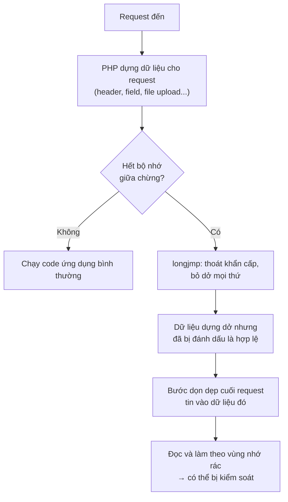
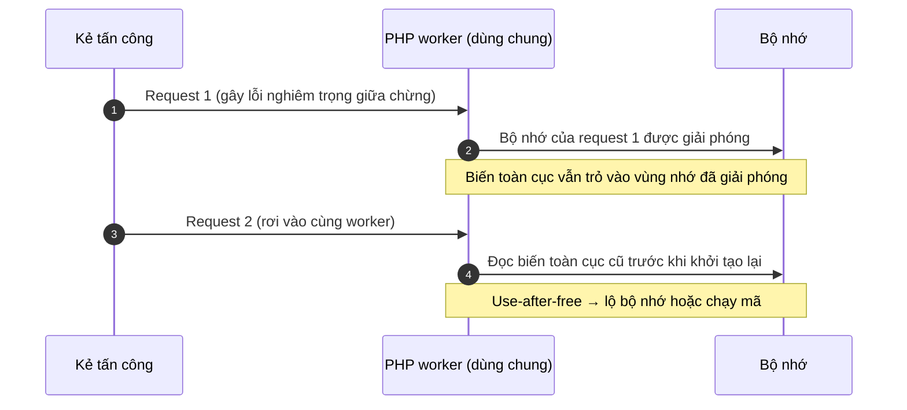

## Mở đầu

Mấy ngày nay nếu khá xôn sao cái tên **PHP2Shell**. Một số cơ quan chính phủ ở châu Âu tạm tắt website để vá, Cloudflare phải bật rule chặn khẩn cấp, còn cơ quan an ninh mạng Anh khuyên hệ thống nào chưa vá được thì nên ngắt khỏi internet.

Lý do đơn giản: đây là **hai lỗ hổng nằm ngay trong lõi PHP**, không phải trong một plugin hay một framework nào. Kẻ tấn công không cần tài khoản, chỉ cần gửi một HTTP request là có thể tiến tới chạy mã tùy ý trên máy chủ. Mà PHP đang chạy phía sau khoảng **70% website** xác định được công nghệ phía server từ WordPress, Laravel, Magento cho tới các hệ thống nội bộ cũ kỹ ít ai nhớ tới.

## TL;DR

- **PHP2Shell** là tên gọi chung của hai lỗi: **CVE-2026-109618** và **CVE-2026-109619**, đều chấm **9.2 / CVSS v4.0 (Critical)**.
- Cả hai đều là lỗi **quản lý bộ nhớ** trong PHP. Khai thác thành công cho phép **(RCE) mà không cần đăng nhập**, với quyền của tiến trình web (www-data, apache...).
- Lỗi xảy ra ở giai đoạn PHP đang đọc request, **trước khi code ứng dụng chạy**. Vì vậy WordPress hay Laravel có "sạch" đến đâu cũng không cứu được.
- **Đã có khai thác thật ngoài đời.** Amazon ghi nhận nỗ lực khai thác từ 17/10, bốn ngày trước khi công bố.
- **Cách sửa duy nhất đáng tin: nâng PHP lên bản vá rồi restart toàn bộ worker.** Các bản vá: **8.5.12, 8.4.27, 8.3.36, 8.2.35**.
- PHP 8.1 trở xuống **không có bản vá chính thức**.

| Thuộc tính | Giá trị |
| --- | --- |
| Tên gọi | PHP2Shell |
| CVE-2026-109618 | "RCE via OOM corruption": hỏng bộ nhớ khi PHP hết RAM giữa chừng |
| CVE-2026-109619 | "RCE via stale global state": trạng thái cũ còn sót lại giữa các request |
| Thành phần | PHP core (runtime, lúc xử lý request) |
| Xác thực | Không cần |
| CVSS v4.0 | 9.2 cho cả hai (theo advisory của PHP) |
| Tác động | RCE với quyền của web worker, lộ nội dung bộ nhớ |
| Công bố | 21/10/2026 |

## 1. Hiểu bug này 

### PHP xử lý một request thế nào?

Hãy hình dung mỗi **PHP worker** là một **đầu bếp** trong nhà hàng. Mỗi **request** là một **đơn hàng**.

- Với mỗi đơn, đầu bếp dựng một **khay nguyên liệu** (vùng nhớ dành riêng cho request đó).
- Làm xong đơn thì **đổ khay đi, dọn sạch**.
- Rồi nhận đơn tiếp theo. Cùng một đầu bếp phục vụ rất nhiều khách liên tiếp, nên cái gì dọn chưa sạch sẽ ảnh hưởng tới **khách sau**.

Ngoài ra, PHP có **`memory_limit`**: mỗi khay chỉ được to tới một cỡ nhất định. Vượt quá là PHP báo hết bộ nhớ (out-of-memory, OOM) và hủy đơn.

Lỗi nằm ở chỗ **hủy đơn không gọn**.

### Lỗi #1 (CVE-2026-109618): bỏ dở đơn hàng, để lại khay bày dở

Khi hết bộ nhớ, PHP không "dừng lại từ từ" mà dùng một cơ chế thoát khẩn cấp trong ngôn ngữ C là `longjmp()`. Nó giống việc đầu bếp bấm **nút thoát hiểm**: bỏ ngang mọi thứ đang làm.

Vấn đề là ở một số đoạn code, PHP **đã ghi nhãn "ô này có hàng rồi"** trước khi thực sự **xin được chỗ để chứa hàng**. Nếu đúng lúc đó hết bộ nhớ và bấm thoát hiểm, ta có một cái khay mà **nhãn nói có hàng nhưng bên trong là rác còn sót từ trước**.

Sau đó bước dọn dẹp cuối request vẫn **tin vào cái nhãn** và lục vào chỗ rác đó, làm theo những gì nó "đọc" được. Nếu kẻ tấn công kiểm soát được thứ nằm trong đống rác này, họ có thể điều khiển được chương trình.

Kẻ tấn công không cần đợi may mắn. Theo [advisory của PHP](https://github.com/php/php-src/security/advisories/GHSA-w8hw-w9fx-j79w), một request kiểu multipart (loại dùng cho form upload file) có thể được thiết kế để **ngốn RAM nhiều hơn rất nhiều so với kích thước thực của nó**, nên vẫn qua được giới hạn `post_max_size` mà vẫn làm PHP hết bộ nhớ.

### Lỗi #2 (CVE-2026-109619): bảng ghi chú cũ vẫn treo trên tường

Lỗi thứ hai tinh vi hơn. PHP có một số **biến toàn cục** (global state) sống lâu hơn một request, ví dụ trạng thái lỗi, session, extension. Hãy tưởng tượng đó là **bảng ghi chú dán trên tường bếp**, ghi kiểu "nguyên liệu để ở ngăn số 5 của khay hiện tại".

Bình thường hết đơn thì ghi chú được xóa. Nhưng nếu đơn bị **chết giữa chừng** (lỗi nghiêm trọng, hết thời gian chạy, hết RAM...) thì bước xóa ghi chú bị bỏ qua. Khay thì đã đổ đi, còn **ghi chú vẫn chỉ vào chỗ cũ**.

Khi khách tiếp theo tới đúng người đầu bếp đó, đầu bếp **đọc cái ghi chú lỗi thời** trước khi kịp khởi tạo lại, và lấy đồ ở một chỗ giờ đã bị thứ khác chiếm. Giới bảo mật gọi là **use-after-free**: dùng vùng nhớ sau khi đã trả lại.

PHP gọi hai vai trò này là *producer* và *consumer*:

- **Producer** (kẻ để lại ghi chú cũ): một request gây ra lỗi nghiêm trọng, hết thời gian chạy, hết RAM...
- **Consumer** (kẻ đọc nhầm ghi chú): một request sau đó chạm vào trạng thái cũ trước khi nó được dọn.

Điều kiện: hai request phải rơi vào **cùng một worker**.

### Vì sao hai bug này nguy hiểm hơn thông thường

Hầu hết lỗi web hay gặp (SQL injection, XSS, upload bừa...) nằm trong **code ứng dụng**. Có thể chặn bằng validate input, đặt thêm đăng nhập, cài plugin bảo mật.

PHP2Shell thì khác: nó xảy ra ở giai đoạn **PHP đang đọc và phân tích request**, *trước khi* WordPress, Laravel hay bất kỳ dòng code nào của bạn được chạy. Nghĩa là:

- Không cần tài khoản, không cần biết app của bạn có endpoint nào.
- Mọi lớp kiểm tra nằm trong ứng dụng đều chưa kịp chạy.
- Với Apache `mod_php`, request độc hại có thể hoạt động ngay ở tầng này.

## 2. Điều kiện cần 

Lúc mới được công bố chuỗi lỗi này rất rầm rộ nhưng mình đã thử qua rất nhiều poc trên github và nhận ra là để RCE thông qua chuỗi này sẽ phức tạp hơn ta tưởng 

Vector CVSS của cả hai lỗi ghi **AC:H** (độ phức tạp tấn công cao) và **AT:P** (cần một số điều kiện môi trường nhất định phải đúng). Lý do: kẻ tấn công phải **đặt dữ liệu của mình đúng vào chỗ bộ nhớ đã bị giải phóng**, trên đúng worker. Lệch một chút thì kết quả thường chỉ là worker bị crash chứ chưa chắc chạy được mã.

### Kẻ tấn công cần gì?

Cứ hình dung kẻ tấn công muốn **đánh tráo đồ trong bếp đúng lúc đầu bếp sơ hở**. Để làm được, họ cần cả 3 thứ:

1. **Gửi được request tới PHP.** Không cần đăng nhập.
2. **Làm đầu bếp "vấp" đúng cách.** Lỗi #1 là làm PHP hết RAM giữa chừng, lỗi #2 là để lại một "ghi chú cũ" rồi bắt đầu bếp đọc nhầm (chi tiết ở dưới).
3. **Nhét dữ liệu của mình đúng vào chỗ vừa bị bỏ trống.** Đây là bước khó nhất. Nó phụ thuộc vào bản build PHP, extension đang bật, nginx/proxy phía trước và cách PHP chia bộ nhớ. Thêm worker hay thêm traffic không chặn được, chỉ buộc kẻ tấn công phải thử nhiều lần hơn.

Làm được cả ba thì kẻ tấn công chạy được lệnh với quyền của tài khoản chạy web (www-data, apache...).

|  | Lỗi #1 (CVE-2026-109618) | Lỗi #2 (CVE-2026-109619) |
| --- | --- | --- |
| Ý tưởng | Ép PHP hết RAM giữa chừng | Để lại "ghi chú cũ", request sau đọc nhầm |
| Số request cần | 1 | 2, rơi đúng cùng một worker |
| Dính nặng nhất | `mod_php` | `mod_php` |

### Lỗi #1 cần gì?

Hình ảnh: đầu bếp đang bày nguyên liệu ra khay thì **hết chỗ đặt khay**, bấm nút thoát hiểm và để lại một cái khay bày dở.

**Điều kiện 1: ép PHP hết RAM khi đang đọc request.**

Kẻ tấn công dùng request upload file (loại multipart) được dựng sao cho nhìn thì nhỏ nhưng PHP phải tốn rất nhiều RAM để xử lý. Advisory nêu mấy cách:

- Nhét **cực nhiều header** vào một phần của request.
- Gửi hàng loạt **ô upload file rỗng**. Các ô rỗng này không tính vào `max_file_uploads` nhưng PHP vẫn phải tạo dữ liệu cho từng ô.
- Đặt **tên field lồng nhiều tầng** để khối lượng việc nhân lên.

Vì vậy chỉ chỉnh `post_max_size` thì chưa đủ: request vẫn "nhỏ" trên đường truyền, còn RAM PHP dùng thì phình ra gấp nhiều lần.

**Điều kiện 2: cách chạy PHP vẫn dọn dẹp tiếp dù request đã hỏng giữa chừng.**

- `mod_php` vẫn dọn tiếp, nên bị nặng nhất. RCE hoàn chỉnh đã được chứng minh với cấu hình mặc định.
- PHP-FPM thì giết luôn tiến trình con khi request khởi động hỏng, nên khó hơn.

> Bỏ giới hạn RAM (`memory_limit=-1`) cũng không cứu được. Khi máy thật sự không cấp thêm được RAM, PHP vẫn rơi vào đúng đường lỗi đó.
{: .prompt-info }

### Lỗi #2 cần gì?

Hình ảnh: đầu bếp bị gián đoạn nên **quên gỡ tờ ghi chú** trên tường. Đơn kế tiếp đến, đầu bếp **đọc nhầm tờ ghi chú cũ**.

Vì vậy kẻ tấn công cần **2 request nối nhau**, phải rơi vào **cùng một worker**:

**Request 1: để lại ghi chú cũ.** Làm một request kết thúc giữa chừng không gọn. Advisory kể ra: lỗi cú pháp, lỗi không được bắt, `require` file thất bại, chạy quá thời gian (`Maximum execution time exceeded`). Hết RAM cũng được.

**Request 2: đọc nhầm ghi chú.** Request này phải vào đúng worker đó và bị PHP đọc ghi chú cũ **ngay từ lúc khởi động**, trước khi PHP kịp dọn. Có hai "cửa" để việc này xảy ra:

- **Cửa 1: lúc PHP áp các cấu hình riêng cho request** (như `.htaccess` hay `php_value`) mà phát sinh một cảnh báo nhỏ. Cảnh báo này **không cần hiện ra màn hình hay ghi vào log**, nên tắt `display_errors` hay chỉnh `error_reporting` không giúp được gì.
- **Cửa 2: tính năng theo dõi tiến độ upload của session** (`session.upload_progress`). Tính năng này **bật sẵn mặc định**, và ứng dụng không cần dùng session.

**Cách chạy PHP quyết định cửa nào mở:**

- `mod_php`: `.htaccess` và `php_value` được áp ngay từ đầu request, nên mở cả hai cửa.
- PHP-FPM: cửa 1 chỉ mở khi nginx (hoặc Apache `mod_proxy_fcgi`) phía trước truyền `PHP_VALUE` xuống. Cửa 2 mở được, nhưng cần ứng dụng có một thao tác phù hợp để làm request 1.
- PHP 8.5 bật `fatal_error_backtraces` (in vết gọi hàm khi gặp lỗi nghiêm trọng): đây là đường mạnh nhất, RCE đã được xác nhận trên `mod_php`.
- FrankenPHP, LiteSpeed (LSAPI): mới dừng ở phân tích mã nguồn, chưa chứng minh. PHP nhấn mạnh điều này "không có nghĩa là miễn nhiễm".

### Cách chạy PHP nào rủi ro nhất?

| Cách chạy PHP | Mức rủi ro |
| --- | --- |
| **`mod_php`** | **Cao nhất.** RCE hoàn chỉnh đã được chứng minh qua HTTP với cấu hình mặc định |
| **PHP-FPM** | **Thấp hơn nhưng không an toàn.** Lỗi #1 bị hạn chế, lỗi #2 đã được kiểm chứng qua session upload progress |
| **FrankenPHP** | Nhiều khả năng bị ảnh hưởng, chưa chứng minh đầy đủ |
| **LSAPI / LiteSpeed** | Có khả năng, chưa kiểm chứng |

## 3. Chuyện gì đã xảy ra?

| Ngày | Sự kiện |
| --- | --- |
| **17/10** | Hệ thống honeypot MadPot của Amazon ghi nhận một nỗ lực khai thác, **bốn ngày trước khi công bố**. Chưa rõ kẻ tấn công lấy thông tin ở đâu ra |
| **20/10** | Thông tin dưới embargo bị lộ trước giờ G. watchTowr xác nhận lỗi là thật; PHP báo trước sẽ có bản vá khẩn vào hôm sau |
| **21/10** | PHP công bố advisory, phát hành 8.5.12 / 8.4.27 / 8.3.36 / 8.2.35. NCSC (Anh) cảnh báo. watchTowr thấy khai thác trên honeypot của họ |
| **22/10** | Các hãng thiết bị bắt đầu rà soát sản phẩm (Palo Alto, Fortinet, Cisco...) |

Trong thời gian đó, Cloudflare cho biết đã thấy các đợt tấn công sớm và triển khai rule WAF tạm thời cho mọi khách hàng, kể cả gói miễn phí ([BleepingComputer](https://bleepingcomputer.com/news/security/php-ships-emergency-patches-for-critical-php2shell-flaws), [Help Net Security](https://www.helpnetsecurity.com/2026/10/21/php2shell-php-vulnerabilities-patched-cve-2026-109618-cve-2026-109619/)). VirusTotal ước tính có hơn **5,1 triệu host PHP** đang lộ ra internet (cũng theo BleepingComputer). Một số cơ quan nhà nước tạm ngắt website: trang chính phủ Phần Lan bị gián đoạn một phần ([AP](https://www.adn.com/nation-world/2026/10/21/websites-scramble-to-fix-software-flaw-that-could-put-much-of-internet-at-risk/)), còn NCSC Hà Lan tự gỡ website của mình xuống ([Techzine](https://www.techzine.eu/blogs/security/145168/php-shuts-the-internet-why-php2shell-affects-every-company/)). Theo AP, FBI khuyến nghị: nếu chưa cập nhật được thì nên đưa website offline.

## Tài liệu tham khảo

- [PHP Security Advisory GHSA-w8hw-w9fx-j79w (CVE-2026-109618): RCE via OOM corruption](https://github.com/php/php-src/security/advisories/GHSA-w8hw-w9fx-j79w)
- [PHP Security Advisory GHSA-6wmf-4rv5-p3rp (CVE-2026-109619): RCE via stale global state](https://github.com/php/php-src/security/advisories/GHSA-6wmf-4rv5-p3rp)
- [BleepingComputer: PHP ships emergency patches for critical PHP2Shell flaws](https://bleepingcomputer.com/news/security/php-ships-emergency-patches-for-critical-php2shell-flaws)
- [Help Net Security: PHP2Shell, critical PHP vulnerabilities patched](https://www.helpnetsecurity.com/2026/10/21/php2shell-php-vulnerabilities-patched-cve-2026-109618-cve-2026-109619/)
- [watchTowr: PHP2Shell RCE Exploited](https://watchtowr.com/intelligence/php-remote-code-execution-php2shell/) và [bản FAQ](https://watchtowr.com/intelligence/php-cve-2026-109618-faq/)
- [Imperva: PHP2Shell, When PHP Runs Out of Memory at the Wrong Moment](https://www.imperva.com/blog/php2shell-vulnerability-updates/)
- [SecurityWeek: Mass Exploitation Looms for Leaked Critical PHP Flaws](https://www.securityweek.com/php2shell-mass-exploitation-looms-for-leaked-critical-php-flaws/)
- [Techzine: PHP shuts the internet, why PHP2Shell affects every company](https://www.techzine.eu/blogs/security/145168/php-shuts-the-internet-why-php2shell-affects-every-company/)
- [AP (qua ADN): Websites scramble to fix software flaw that could put much of internet at risk](https://www.adn.com/nation-world/2026/10/21/websites-scramble-to-fix-software-flaw-that-could-put-much-of-internet-at-risk/)
- [Wikipedia: PHP2Shell](https://en.wikipedia.org/wiki/PHP2Shell)
