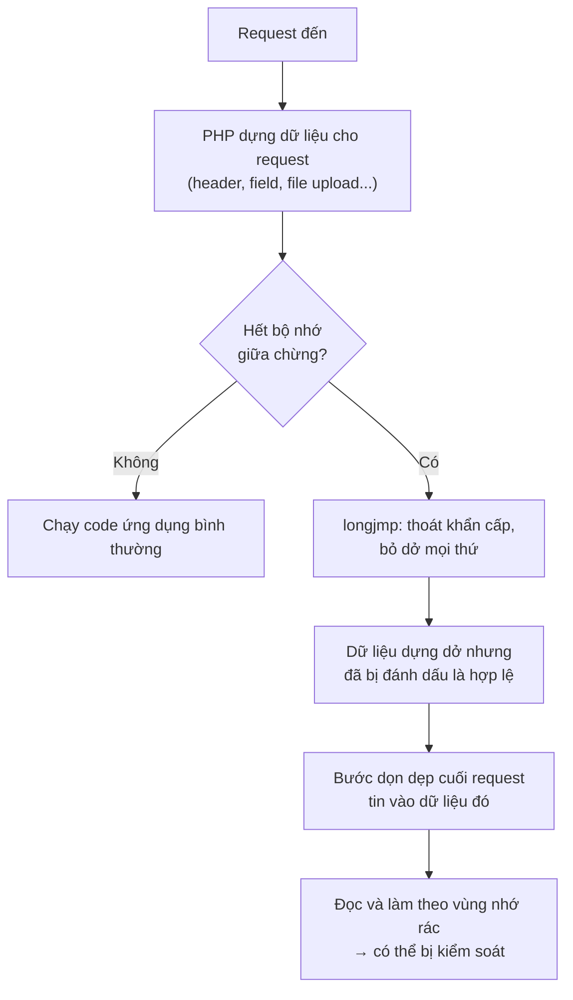
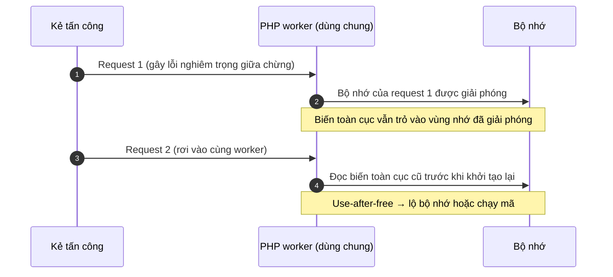

## Mở đầu

Mấy ngày nay nếu có lướt qua các trang tin bảo mật, chắc bạn đã gặp cái tên **PHP2Shell**. Một số cơ quan chính phủ ở châu Âu tạm tắt website để vá, Cloudflare phải bật rule chặn khẩn cấp, còn cơ quan an ninh mạng Anh (NCSC) khuyên hệ thống nào chưa vá được thì nên ngắt khỏi internet.

Lý do đơn giản: đây là **hai lỗ hổng nằm ngay trong lõi PHP**, không phải trong một plugin hay một framework nào. Kẻ tấn công không cần tài khoản, chỉ cần gửi một HTTP request là có thể tiến tới chạy mã tùy ý trên máy chủ. Mà PHP đang chạy phía sau khoảng **70% website** xác định được công nghệ phía server (theo Arctic Wolf, dẫn lại trong [bài của AP](https://www.adn.com/nation-world/2026/10/21/websites-scramble-to-fix-software-flaw-that-could-put-much-of-internet-at-risk/)), từ WordPress, Laravel, Magento cho tới các hệ thống nội bộ cũ kỹ ít ai nhớ tới.

Bài này mình viết cho cả những bạn không làm bảo mật chuyên sâu. Đọc xong bạn sẽ biết lỗi là gì (bằng ví dụ đời thường), mình có bị ảnh hưởng không, và việc cần làm ngay hôm nay.

> Thông tin trong bài tính đến **23/10/2026**. Sự việc vẫn đang diễn biến (số liệu, bản vá của các hãng, tình trạng khai thác) nên hãy đối chiếu lại với các nguồn ở cuối bài.
{: .prompt-info }

## TL;DR

- **PHP2Shell** là tên gọi chung của hai lỗi: **CVE-2026-109618** và **CVE-2026-109619**, đều chấm **9.2 / CVSS v4.0 (Critical)**.
- Cả hai đều là lỗi **quản lý bộ nhớ** trong PHP. Khai thác thành công cho phép **chạy mã từ xa (RCE) mà không cần đăng nhập**, với quyền của tiến trình web (www-data, apache...).
- Lỗi xảy ra ở giai đoạn PHP đang đọc request, **trước khi code ứng dụng chạy**. Vì vậy WordPress hay Laravel có "sạch" đến đâu cũng không cứu được.
- **Đã có khai thác thật ngoài đời.** Amazon ghi nhận nỗ lực khai thác từ 17/10, bốn ngày trước khi công bố.
- **Cách sửa duy nhất đáng tin: nâng PHP lên bản vá rồi restart toàn bộ worker.** Các bản vá: **8.5.12, 8.4.27, 8.3.36, 8.2.35**.
- PHP 8.1 trở xuống **không có bản vá chính thức**: dùng gói backport của distro/LTS, hoặc nâng cấp.

| Thuộc tính | Giá trị |
| --- | --- |
| Tên gọi | PHP2Shell |
| CVE-2026-109618 | "RCE via OOM corruption": hỏng bộ nhớ khi PHP hết RAM giữa chừng |
| CVE-2026-109619 | "RCE via stale global state": trạng thái cũ còn sót lại giữa các request |
| Thành phần | PHP core (runtime, lúc xử lý request) |
| Xác thực | Không cần |
| CVSS v4.0 | 9.2 cho cả hai (theo advisory của PHP) |
| Tác động | RCE với quyền của web worker, lộ nội dung bộ nhớ |
| Công bố | 21/10/2026 |

## 1. Bạn có đang bị ảnh hưởng không?

Nếu PHP của bạn **phục vụ web request** thì nên coi là có. watchTowr nói rõ: *mọi cài đặt PHP phục vụ web đều nằm trong phạm vi*, kể cả server nội bộ hoặc con server cũ bị lãng quên. Cách bạn chạy PHP (Apache `mod_php`, PHP-FPM, php-cgi, FrankenPHP, LiteSpeed) không giúp bạn thoát khỏi phạm vi này.

| Nhánh PHP | Trạng thái | Bản cần lên |
| --- | --- | --- |
| 8.5.x | Bị ảnh hưởng nếu < 8.5.12 | **8.5.12** |
| 8.4.x | Bị ảnh hưởng nếu < 8.4.27 | **8.4.27** |
| 8.3.x | Bị ảnh hưởng nếu < 8.3.36 | **8.3.36** |
| 8.2.x | Bị ảnh hưởng nếu < 8.2.35 | **8.2.35** |
| 8.1, 8.0, 7.4 | Bị ảnh hưởng, hết hỗ trợ | Không có bản chính thức. Dùng gói của distro/LTS vendor, hoặc patch backport tối thiểu mà PHP phát hành cho người tự build từ source |
| 7.3 trở xuống (kể cả PHP 5) | Bị ảnh hưởng, không có bản vá | Phải nâng lên nhánh còn hỗ trợ |

Một vài lưu ý để khỏi hiểu nhầm:

- **Lỗi nằm ở PHP, không phải ở WordPress hay Laravel.** Cập nhật plugin hay framework không giải quyết được gì, bạn phải cập nhật chính PHP.
- **nginx không "miễn nhiễm".** nginx không tự chạy PHP mà thường đẩy sang PHP-FPM, và PHP-FPM nằm trong danh sách bị ảnh hưởng.
- Các nguồn cho rằng lỗi tồn tại từ rất lâu, có nguồn nói từ PHP 5.4 (ra mắt năm 2012). Tuy nhiên theo [Imperva](https://www.imperva.com/blog/php2shell-vulnerability-updates/), không phải mọi bản cũ đều đã được kiểm chứng. Với bản cũ, cứ coi là bị ảnh hưởng.
- Không chỉ web server của bạn. Thiết bị có giao diện quản trị viết bằng PHP cũng có thể dính. Theo [Help Net Security](https://www.helpnetsecurity.com/2026/10/21/php2shell-php-vulnerabilities-patched-cve-2026-109618-cve-2026-109619/) (cập nhật 22/10), Palo Alto Networks cho biết mọi bản PAN-OS/Panorama bị ảnh hưởng và lúc đó chưa có bản vá; Fortinet và Cisco vẫn đang điều tra.

## 2. Hiểu lỗi trong 5 phút

### Kiến thức nền: PHP xử lý một request thế nào?

Hãy hình dung mỗi **PHP worker** là một **đầu bếp** trong nhà hàng. Mỗi **request** là một **đơn hàng**.

- Với mỗi đơn, đầu bếp dựng một **khay nguyên liệu** (vùng nhớ dành riêng cho request đó).
- Làm xong đơn thì **đổ khay đi, dọn sạch**.
- Rồi nhận đơn tiếp theo. Cùng một đầu bếp phục vụ rất nhiều khách liên tiếp, nên cái gì dọn chưa sạch sẽ ảnh hưởng tới **khách sau**.

Ngoài ra, PHP có **`memory_limit`**: mỗi khay chỉ được to tới một cỡ nhất định. Vượt quá là PHP báo hết bộ nhớ (out-of-memory, OOM) và hủy đơn.

Lỗi nằm ở chỗ **hủy đơn không gọn**.

### Lỗi #1 (CVE-2026-109618): bỏ dở đơn hàng, để lại khay bày dở

Khi hết bộ nhớ, PHP không "dừng lại từ từ" mà dùng một cơ chế thoát khẩn cấp trong ngôn ngữ C là `longjmp()`. Nó giống việc đầu bếp bấm **nút thoát hiểm**: bỏ ngang mọi thứ đang làm.

Vấn đề là ở một số đoạn code, PHP **đã ghi nhãn "ô này có hàng rồi"** trước khi thực sự **xin được chỗ để chứa hàng**. Nếu đúng lúc đó hết bộ nhớ và bấm thoát hiểm, ta có một cái khay mà **nhãn nói có hàng nhưng bên trong là rác còn sót từ trước**.

Sau đó bước dọn dẹp cuối request vẫn **tin vào cái nhãn** và lục vào chỗ rác đó, làm theo những gì nó "đọc" được. Nếu kẻ tấn công kiểm soát được thứ nằm trong đống rác này, họ có thể điều khiển được chương trình.



Kẻ tấn công không cần đợi may mắn. Theo [advisory của PHP](https://github.com/php/php-src/security/advisories/GHSA-w8hw-w9fx-j79w), một request kiểu multipart (loại dùng cho form upload file) có thể được thiết kế để **ngốn RAM nhiều hơn rất nhiều so với kích thước thực của nó**, nên vẫn qua được giới hạn `post_max_size` mà vẫn làm PHP hết bộ nhớ.

### Lỗi #2 (CVE-2026-109619): bảng ghi chú cũ vẫn treo trên tường

Lỗi thứ hai tinh vi hơn. PHP có một số **biến toàn cục** (global state) sống lâu hơn một request, ví dụ trạng thái lỗi, session, extension. Hãy tưởng tượng đó là **bảng ghi chú dán trên tường bếp**, ghi kiểu "nguyên liệu để ở ngăn số 5 của khay hiện tại".

Bình thường hết đơn thì ghi chú được xóa. Nhưng nếu đơn bị **chết giữa chừng** (lỗi nghiêm trọng, hết thời gian chạy, hết RAM...) thì bước xóa ghi chú bị bỏ qua. Khay thì đã đổ đi, còn **ghi chú vẫn chỉ vào chỗ cũ**.

Khi khách tiếp theo tới đúng người đầu bếp đó, đầu bếp **đọc cái ghi chú lỗi thời** trước khi kịp khởi tạo lại, và lấy đồ ở một chỗ giờ đã bị thứ khác chiếm. Giới bảo mật gọi là **use-after-free**: dùng vùng nhớ sau khi đã trả lại.

PHP gọi hai vai trò này là *producer* và *consumer*:

- **Producer** (kẻ để lại ghi chú cũ): một request gây ra lỗi nghiêm trọng, hết thời gian chạy, hết RAM...
- **Consumer** (kẻ đọc nhầm ghi chú): một request sau đó chạm vào trạng thái cũ trước khi nó được dọn.

Điều kiện: hai request phải rơi vào **cùng một worker**.



### Vì sao hai lỗi này đáng sợ hơn lỗi PHP thông thường?

Hầu hết lỗi web mình hay gặp (SQL injection, XSS, upload bừa...) nằm trong **code ứng dụng**. Có thể chặn bằng validate input, đặt thêm đăng nhập, cài plugin bảo mật.

PHP2Shell thì khác: nó xảy ra ở giai đoạn **PHP đang đọc và phân tích request**, *trước khi* WordPress, Laravel hay bất kỳ dòng code nào của bạn được chạy. Nghĩa là:

- Không cần tài khoản, không cần biết app của bạn có endpoint nào.
- Mọi lớp kiểm tra nằm trong ứng dụng đều chưa kịp chạy.
- Với Apache `mod_php`, request độc hại có thể hoạt động ngay ở tầng này.

## 3. Cứ gửi request là bị chiếm quyền sao?

Không đơn giản như vậy, và biết điều này giúp mình đánh giá rủi ro đúng thay vì hoảng loạn hay chủ quan.

Vector CVSS của cả hai lỗi ghi **AC:H** (độ phức tạp tấn công cao) và **AT:P** (cần một số điều kiện môi trường nhất định phải đúng). Lý do: kẻ tấn công phải **đặt dữ liệu của mình đúng vào chỗ bộ nhớ đã bị giải phóng**, trên đúng worker. Lệch một chút thì kết quả thường chỉ là worker bị crash chứ chưa chắc chạy được mã.

Mức độ rủi ro cũng khác nhau theo cách chạy PHP, theo hai advisory:

| Cách chạy PHP | Mức rủi ro theo advisory |
| --- | --- |
| **Apache `mod_php`** | Cao nhất. Đã chứng minh RCE hoàn chỉnh qua HTTP với cấu hình giới hạn mặc định và prefork workers |
| **PHP-FPM** | Có hạn chế hơn: tiến trình con bị giết khi khởi động request thất bại. Nhưng lỗi #2 qua *session upload progress* đã được kiểm chứng trên FPM |
| **FrankenPHP** | Phân tích mã nguồn cho thấy nhiều khả năng bị ảnh hưởng, nhưng chưa chứng minh đầy đủ |
| **LSAPI / LiteSpeed** | Có khả năng, chưa được kiểm chứng |

Nhưng "khó" không có nghĩa là "an toàn". Kẻ tấn công có thể gửi rất nhiều request, mỗi lần thất bại chỉ là một cái worker bị crash rồi sinh lại. Và như phần dưới sẽ thấy, **khai thác thật đã xảy ra**.

## 4. Chuyện gì đã xảy ra?

| Ngày | Sự kiện |
| --- | --- |
| **17/10** | Hệ thống honeypot MadPot của Amazon ghi nhận một nỗ lực khai thác, **bốn ngày trước khi công bố**. Chưa rõ kẻ tấn công lấy thông tin ở đâu ra |
| **20/10** | Thông tin dưới embargo bị lộ trước giờ G. watchTowr xác nhận lỗi là thật; PHP báo trước sẽ có bản vá khẩn vào hôm sau |
| **21/10** | PHP công bố advisory, phát hành 8.5.12 / 8.4.27 / 8.3.36 / 8.2.35. NCSC (Anh) cảnh báo. watchTowr thấy khai thác trên honeypot của họ |
| **22/10** | Các hãng thiết bị bắt đầu rà soát sản phẩm (Palo Alto, Fortinet, Cisco...) |

Trong thời gian đó, Cloudflare cho biết đã thấy các đợt tấn công sớm và triển khai rule WAF tạm thời cho mọi khách hàng, kể cả gói miễn phí ([BleepingComputer](https://bleepingcomputer.com/news/security/php-ships-emergency-patches-for-critical-php2shell-flaws), [Help Net Security](https://www.helpnetsecurity.com/2026/10/21/php2shell-php-vulnerabilities-patched-cve-2026-109618-cve-2026-109619/)). VirusTotal ước tính có hơn **5,1 triệu host PHP** đang lộ ra internet (cũng theo BleepingComputer). Một số cơ quan nhà nước tạm ngắt website: trang chính phủ Phần Lan bị gián đoạn một phần ([AP](https://www.adn.com/nation-world/2026/10/21/websites-scramble-to-fix-software-flaw-that-could-put-much-of-internet-at-risk/)), còn NCSC Hà Lan tự gỡ website của mình xuống ([Techzine](https://www.techzine.eu/blogs/security/145168/php-shuts-the-internet-why-php2shell-affects-every-company/)). Theo AP, FBI khuyến nghị: nếu chưa cập nhật được thì nên đưa website offline.

### Ai tìm ra, và vì sao nhiều người nhắc tới AI?

Theo [BleepingComputer](https://bleepingcomputer.com/news/security/php-ships-emergency-patches-for-critical-php2shell-flaws), các lỗi được báo cáo bởi nhóm nghiên cứu ở **Calif, Wiz và OpenAI**. Theo trang [Wikipedia](https://en.wikipedia.org/wiki/PHP2Shell) về sự kiện này, Ryan Austin (Calif) tìm ra lỗi khi rà soát source PHP bằng mô hình GPT-5.6 Sol của OpenAI, còn Wiz độc lập phát triển exploit bằng các mô hình AI. Trang này đang được cập nhật liên tục nên mình chỉ dùng nó để tham khảo.

OpenAI cho rằng AI dường như đã tìm ra các lỗ hổng *trước* kẻ tấn công và dự đoán những phát hiện kiểu này sẽ tăng mạnh trong vài tháng tới. Ismael Valenzuela của Arctic Wolf nhận xét: *"Điều thay đổi không phải là mã nguồn, mà là khả năng tìm ra các điểm yếu đó và biến chúng thành exploit chạy được"*, và có những lỗi đã tồn tại hơn một thập kỷ.

## 5. Làm gì ngay hôm nay?

### Bước 1: Biết mình đang chạy PHP gì, ở đâu

Một cái bẫy hay gặp: `php -v` chỉ cho biết bản PHP **dòng lệnh**, không chắc là bản đang phục vụ web.

```bash
php -v                      # PHP CLI, có thể KHÁC với bản chạy web
php-fpm -v                  # hoặc php-fpm8.3 -v, tùy bản cài
apache2ctl -M | grep php    # Apache có đang nạp mod_php không?
```

Nếu cần chắc chắn, có thể tạo tạm file `phpinfo()` rồi **xóa ngay** sau khi xem (để lại là lộ thông tin). Đừng quên các nơi dễ bị bỏ sót: container Docker cũ, server staging, tool nội bộ, VPS lâu không đụng tới.

### Bước 2: Vá và restart

1. Cập nhật PHP lên bản đúng nhánh trong bảng ở mục 1 (qua package manager của distro, image Docker mới, hoặc nhà cung cấp hosting).
2. **Restart toàn bộ worker**, nếu không tiến trình cũ vẫn chạy bản mã cũ:

   ```bash
   sudo systemctl restart php8.3-fpm   # tên service tùy phiên bản/distro
   sudo systemctl restart apache2      # nếu dùng mod_php
   ```

3. Docker: **build lại image** từ base image PHP đã vá rồi deploy lại, đừng chỉ `pull` rồi để container cũ chạy.
4. Dùng PHP 8.1 trở xuống: lấy gói từ distro/LTS vendor, hoặc dùng patch backport của PHP, hoặc nâng cấp.
5. Dùng shared hosting hoặc WordPress hosting: bạn không tự vá được, hãy xem thông báo của nhà cung cấp hoặc hỏi họ.

> Distro như Debian/Ubuntu thường **backport bản vá mà không đổi số phiên bản PHP gốc**, nên `php -v` có thể vẫn hiện số cũ dù đã được vá. Có thể kiểm tra thêm bằng changelog của gói, ví dụ `apt changelog php8.3-fpm | grep -i CVE-2026-109618` (thay đúng tên gói bạn cài). Nếu distro đã phát hành bản vá thì changelog thường có nhắc CVE; còn không thấy thì xem thông báo bảo mật của distro.
{: .prompt-tip }

### Bước 3: Nếu chưa thể vá ngay

Hãy nhớ: theo PHP, **không có cấu hình nào đóng hoàn toàn lỗ hổng**, đây chỉ là giảm thiểu rủi ro tạm thời.

- **Thu hẹp phạm vi truy cập**: đặt sau VPN/IP allowlist, hoặc ngắt khỏi internet như NCSC và FBI khuyến cáo.
- **Bật WAF** có rule cho PHP2Shell (Cloudflare đã có rule tạm cho mọi gói).
- Nếu không dùng, tắt *session upload progress* rồi restart worker: `session.upload_progress.enabled=0`
- PHP 8.5: đặt `fatal_error_backtraces=0` và restart worker.
- Nếu ứng dụng không cần upload (multipart), chặn loại request này ở phía trước PHP, và giữ `post_max_size` ở mức thấp.
- Các biện pháp mạnh tay hơn (như `memory_limit=-1` kèm giới hạn bằng cgroup) có trong [advisory CVE-2026-109618](https://github.com/php/php-src/security/advisories/GHSA-w8hw-w9fx-j79w). Chỉ làm khi hiểu rõ hệ quả, vì bỏ giới hạn RAM có thể làm sập server theo cách khác.

Hai điều **không** giúp ích: ẩn lỗi bằng `display_errors`, `error_reporting` hay toán tử `@` (lỗi vẫn xảy ra bên trong), và cũng không thể coi WAF là thay thế cho việc vá.

### Bước 4: Kiểm tra xem đã bị xâm nhập chưa

Vá xong **không xóa được backdoor đã được cài trước đó**. Đặc biệt nếu server từng public và chưa vá trong những ngày 17-21/10 thì nên rà soát. Trước khi dọn dẹp, hãy **sao lưu log và các file đáng ngờ** để còn điều tra.

```bash
# File PHP mới hoặc mới bị sửa trong 7 ngày gần đây
find /var/www -type f -name '*.php' -mtime -7 -ls

# Cron job lạ
crontab -l; ls -la /etc/cron.*

# Tiến trình web đang kết nối ra ngoài?
ss -tnp | grep -E 'php|apache|httpd|nginx'
```

Dấu hiệu cần để ý (theo watchTowr và Imperva): request multipart to bất thường hoặc nhiều field lồng nhau, worker PHP liên tục crash hoặc báo hết bộ nhớ, file lạ xuất hiện trong thư mục web, tiến trình PHP có kết nối ra ngoài mà bạn không giải thích được, tài khoản hay cron job mới tạo. Log sạch cũng **chưa chứng minh được** là bạn an toàn.

## 6. Hỏi nhanh đáp gọn

**Mình dùng WordPress, cần làm gì?** Cập nhật **PHP** (qua hosting hoặc server). Cập nhật WordPress hay plugin không giải quyết lỗi này.

**Mình dùng nginx + PHP-FPM, có sao không?** Vẫn nằm trong phạm vi vì PHP-FPM bị ảnh hưởng. Rủi ro khai thác có thể thấp hơn `mod_php`, nhưng không thể bỏ qua.

**Vá xong có cần restart không?** Có. Phải restart PHP-FPM/Apache để worker nạp bản mới.

**Tắt hiển thị lỗi có giảm rủi ro không?** Không. Lỗi vẫn xảy ra bên trong PHP, chỉ là không hiện ra màn hình.

**PHP 7.4 / 8.0 / 8.1 thì sao?** Không có bản chính thức. Lấy gói backport từ distro/LTS, hoặc nâng cấp lên nhánh còn hỗ trợ.

## 7. Bài học rút ra

1. **Không phải mọi lỗ hổng đều nằm trong code của bạn.** Runtime, thư viện và web server cũng cần được theo dõi và cập nhật như ứng dụng.
2. **Khoảng cách giữa "lộ tin" và "bị khai thác" cực ngắn.** Nỗ lực khai thác đầu tiên được ghi nhận từ 17/10, sớm hơn công bố bốn ngày. Việc cần chuẩn bị từ trước là biết mình đang chạy PHP bản nào ở đâu, và có quy trình vá + restart nhanh.
3. **Tốc độ tìm lỗi đang thay đổi.** Khi AI giúp tìm và dựng exploit nhanh hơn, thời gian từ "có lỗi" đến "có exploit" sẽ co lại. Phần phòng thủ cũng cần nhanh tương ứng.

## Tài liệu tham khảo

- [PHP Security Advisory GHSA-w8hw-w9fx-j79w (CVE-2026-109618): RCE via OOM corruption](https://github.com/php/php-src/security/advisories/GHSA-w8hw-w9fx-j79w)
- [PHP Security Advisory GHSA-6wmf-4rv5-p3rp (CVE-2026-109619): RCE via stale global state](https://github.com/php/php-src/security/advisories/GHSA-6wmf-4rv5-p3rp)
- [BleepingComputer: PHP ships emergency patches for critical PHP2Shell flaws](https://bleepingcomputer.com/news/security/php-ships-emergency-patches-for-critical-php2shell-flaws)
- [Help Net Security: PHP2Shell, critical PHP vulnerabilities patched](https://www.helpnetsecurity.com/2026/10/21/php2shell-php-vulnerabilities-patched-cve-2026-109618-cve-2026-109619/)
- [watchTowr: PHP2Shell RCE Exploited](https://watchtowr.com/intelligence/php-remote-code-execution-php2shell/) và [bản FAQ](https://watchtowr.com/intelligence/php-cve-2026-109618-faq/)
- [Imperva: PHP2Shell, When PHP Runs Out of Memory at the Wrong Moment](https://www.imperva.com/blog/php2shell-vulnerability-updates/)
- [SecurityWeek: Mass Exploitation Looms for Leaked Critical PHP Flaws](https://www.securityweek.com/php2shell-mass-exploitation-looms-for-leaked-critical-php-flaws/)
- [Techzine: PHP shuts the internet, why PHP2Shell affects every company](https://www.techzine.eu/blogs/security/145168/php-shuts-the-internet-why-php2shell-affects-every-company/)
- [AP (qua ADN): Websites scramble to fix software flaw that could put much of internet at risk](https://www.adn.com/nation-world/2026/10/21/websites-scramble-to-fix-software-flaw-that-could-put-much-of-internet-at-risk/)
- [Wikipedia: PHP2Shell](https://en.wikipedia.org/wiki/PHP2Shell)
